------------------------------------------------------------------------

<br>

## Introduction

### What we'll cover

In the [previous session](../S12E02_plotting_01/index.qmd),
we used AI through Posit Assistant and GitHub Copilot in Positron
to help us make plots.
Today, we'll use a different kind of AI tool: **Claude Code**, Anthropic's
"agentic" coding tool, which we'll run inside Positron.

We'll start small, by having Claude write a script for a single plot,
and work our way up to tasks that would take you quite a while by yourself:
cleaning up a messy dataset, writing a Quarto report with plots and nicely
formatted tables, giving it Ohio State branding, and building a small Shiny app.
Specifically, we'll cover:

- **Setting up Claude Code** in Positron with an OSU API key
- **Having Claude write, run, and check R code**
- **Giving Claude your files as context**
- **Stopping, steering, and rewinding** Claude while it works
- **Persistent instructions** with a `CLAUDE.md` file
- **A mini-project**: from a messy CSV to a branded Quarto report and a Shiny app

The [appendix](#managing-context-and-cost) covers managing context and cost,
good habits when working with an agent,
and a bonus exercise in which Claude finds and fixes bugs.

We picked these tasks because they are a sweet spot for AI help:
**hard to write, but easy to check**.
Polished tables, interactive plots, and Shiny apps take a lot of code,
using packages and syntax that most of us don't use often enough to remember.
But you can tell at a glance whether a plot, a table, or an app looks and works
the way you want.
Compare this with, say, a statistical analysis,
where code can run without errors and still give subtly wrong results
that are hard to spot.

### From chat to agents

When you use AI through a browser-based chat,
the model can't see your files unless you paste or upload them,
and it can't check whether the code it writes actually works.
**AI agents**, on the other hand, can work inside your editor and:

- **Read** the files in your project, so you don't have to explain or paste them
- **Edit and create** files, showing you each change for approval
- **Run code and commands**, and then **look at the results**,
  including errors and even the plots they made
- _Hack HuggingFace_ [😱]{style="font-size:1.2em;"}

### Posit Assistant vs. Claude Code

Posit Assistant, which we used in the previous session, is also an agent.
And it has a key built-in strength that Claude Code does not have:
it is connected to your **live R session**, so it can see your objects and
run code in your console^[
Positron does make it possible to expose the same functionality for Claude Code,
but that requires some setup and I have not yet tried that.].

On the other hand, Claude Code has the edge in other areas:

- It is a **general-purpose** coding agent and is designed with longer-running,
  multi-step tasks in mind.
- It is a more **mature product** overall. For example,
  we've had authentication problems with Posit Assistant,
  both via GitHub and with an API key, but not with Claude Code.

(Claude Code also comes in other forms, like a command-line program and a desktop app.
Here, we'll use its VS Code extension in Positron.)

### Authentication with an API key

Rather than using a personal account,
we'll authenticate through an API key from OSU's
[Generative AI Service ](https://it.osu.edu/generative-ai-service){target="_blank"},
which is **approved for institutional data up to and including restricted (S4) data**^[
  Posit Assistant can also use an API key, but as mentioned above,
  its authentication sometimes acts up.].
We'll give you a **personal API key** for this session with limited credit.

If you'd like to continue using Claude Code or Posit Assistant in this manner
**after today's Code Club**, you'll have to set this up via the link above ---
but keep in mind that it isn't free,
so your PI (or similar) would need to have funds that can be used for this purpose.

Alternatively (or additionally),
you could get a personal Anthropic subscription.
Per token, this is a _lot_ cheaper than usage with an API key,
but you'll need to pay personally _and_ you shouldn't use it with institutional data.

::: callout-note
#### Learn more

Parts of this session are adapted from my PLNTPTH 5006
("Practical Computing Skills for Omics Data") course material,
which is [publicly available](https://cfaes-bioinfo.github.io/pracs-au26){target="_blank"}
(weeks 8 and 9 cover genAI).

The [lecture slides](https://cfaes-bioinfo.github.io/pracs-au26/week08/w8a_genAI.html){target="_blank"}
cover the use of Generative AI in research and coding more broadly,
whereas the [practical part](https://cfaes-bioinfo.github.io/pracs-au26/week09/w9a_claude.html){target="_blank"}
focuses on using Claude Code in VS Code for Unix shell scripting tasks.
There are also links to further resources and pages on
[GitHub Copilot](https://cfaes-bioinfo.github.io/pracs-au26/bonus/copilot.html){target="_blank"} and more
[advanced Claude Code features](https://cfaes-bioinfo.github.io/pracs-au26/bonus/claude-code.html){target="_blank"}.
:::

## Getting set up

### First installations

If you haven't done so already, please:

1. **Install Positron** and **R version 4.5.0 or higher** ---
   see the [Positron session](../S12E01_positron_01/index.qmd#before-we-start) for details.
   (We'll use the `penguins` data that is built into R since version 4.5.0.)

2. **Install [Quarto](https://quarto.org/docs/get-started/){target="_blank"}**.
   Positron comes with its own copy of Quarto,
   but Claude can't find that copy when it runs commands,
   so it needs a regular Quarto installation to render documents.

3. **Install the R packages** we'll use:

   ```{r}
   install.packages("tidyverse")
   install.packages("gt")
   install.packages("shiny")
   install.packages("bslib")
   ```

   We'll deliberately not install a few other packages that Claude will likely want to use
   (`countrycode`, `gtExtras`, and `ggiraph`),
   so you can see how Claude asks before installing packages.

::: {.callout-note collapse="true"}
#### Windows users: Git for Windows (optional) _(Click to expand)_
On Windows, Claude Code runs commands with PowerShell by default.
If you have [Git for Windows](https://git-scm.com/downloads/win){target="_blank"} installed,
it will use Git Bash instead, which is what it does on Mac and Linux.
Both work for today, so there's no need to install Git for Windows just for this session.
:::

### Create a folder for this session and download the data

1. Create a new folder for this session called, e.g., `codeclub-claude`,
   perhaps inside a folder for Code Club: `Documents/codeclub/codeclub-claude`.

2. Download [this CSV file](factbook.csv){download="factbook.csv"}
   with World Bank data from the previous session,
   and save it in your `codeclub-claude` folder.

3. Open the `codeclub-claude` folder in Positron with `File` > `Open Folder...`,
   and trust the folder when asked.

::: {.callout-note appearance="simple"}
Claude treats the folder that is open in Positron as its "**workspace**":
this is where it will look for files,
and by default the only place where it can make changes.
:::

### Install the Claude Code extension

1. In the **Extensions** view in the Activity Bar, search for "claude",
   and click **Install** for the extension "**Claude Code for VS Code**" by Anthropic.

   {fig-align="center" width="50%" fig-alt="A screenshot of the Extensions side bar showing the Claude Code for VS Code extension by Anthropic with an Install button." .lightbox}

2. If asked whether you trust the publisher "Anthropic",
   click **Trust Publisher & Install**.

   {fig-align="center" width="55%" fig-alt="A screenshot of a pop-up asking 'Do you trust the publisher Anthropic?' with a 'Trust Publisher & Install' button." .lightbox}

### Connect Claude to your API key

To tell Claude to use your API key,
you need a **settings file** called `settings.json` in a folder `.claude` in your Home folder.
Claude reads this file every time it starts up.

Let's set this up:

1. Create the folder and the (empty) file, and open the file in the editor,
   by copying the code below into the Positron **console** and pressing <kbd>Enter</kbd>^[All of this can also be done without code, in a perhaps more intuitive way,
   but the interface will differ between computers, so this is less likely to fail here.]:

   ```{r}
   # Get your Home folder (on Windows, R's "~" points to Documents instead)
   home <- if (.Platform$OS.type == "windows") {
     Sys.getenv("USERPROFILE")
   } else {
     path.expand("~")
   }

   # Create the .claude folder and the settings file
   # (an existing settings file is left alone)
   settings_file <- file.path(home, ".claude", "settings.json")
   dir.create(dirname(settings_file), showWarnings = FALSE)
   if (!file.exists(settings_file)) file.create(settings_file)

   # Open the file in the editor
   file.edit(settings_file)
   ```

2. Paste the following contents into the file that opened in the editor
   (if the file isn't empty because you've used Claude Code before, let us know:
   you'll need to merge the two):

   ```{.json .file filename="&#126;/.claude/settings.json"}
   {
     "env": {
       "ANTHROPIC_BASE_URL": "https://litellm.cloud.osu.edu",
       "ANTHROPIC_AUTH_TOKEN": "API-KEY",
       "ANTHROPIC_DEFAULT_OPUS_MODEL": "claude-opus-5-5",
       "ANTHROPIC_DEFAULT_SONNET_MODEL": "claude-sonnet-5-5",
       "ANTHROPIC_DEFAULT_HAIKU_MODEL": "claude-haiku-5-5",
       "CLAUDE_CODE_DISABLE_EXPERIMENTAL_BETAS": "1"
     },
     "model": "sonnet",
     "effortLevel": "medium",
     "outputStyle": "Concise",
     "theme": "auto"
   }
   ```

3. **Replace the placeholder** `API-KEY` with your personal API key
   as shown below, and save the file:

   ```{.file filename="&#126;/.claude/settings.json (excerpt - with fictional API key)"}
       "ANTHROPIC_AUTH_TOKEN": "bY-7jiuWbfck9DZk34hA_t",
   ```

::: {.callout-note collapse="true"}
#### More about the settings file _(Click to expand)_

The file is in JSON format, a plain-text format with key-value pairs:
a colon `:` separates each key from its value, pairs are separated by commas,
and curly braces `{}` group pairs.
A single missing quote or comma breaks the whole file
(this would be a likely culprit if Claude doesn't pick up your API key).

- `ANTHROPIC_BASE_URL` makes Claude go through OSU's service rather than
  directly to Anthropic.
- `ANTHROPIC_AUTH_TOKEN` is the API key.
- The `MODEL` lines specify which model versions to use.
- `CLAUDE_CODE_DISABLE_EXPERIMENTAL_BETAS` turns off experimental features
  that OSU's service doesn't support, and that would otherwise cause errors.
- `model` and `effortLevel` set the default model (Sonnet) and effort level (Medium).
- `outputStyle` makes Claude's answers shorter and more to the point
  (remove this line if you prefer longer explanations).
- `theme` makes Claude's colors follow your computer's light or dark mode.
:::

::: {.callout-important collapse="true"}
#### Treat the API key like a password _(Click to expand)_
Anyone with your key can use it, and usage costs money and depletes your key's budget.
So never share your key or commit it to a Git repository.
That's one reason the settings file is located in your Home folder,
and not in a project folder that others may see.
:::

### Open Claude

Open Claude Code by clicking the Claude icon at the top of the secondary (right-hand)
side bar --- the one with the blue line under it in the screenshot below:

{fig-align="center" width="50%" fig-alt="A screenshot of Positron with the Claude icon in the secondary side bar." .lightbox}

::: {.callout-tip collapse="true"}
#### Alternatively, open Claude in the editor pane _(Click to expand)_

You can also click the **orange** Claude icon in the top-right corner of the editor.
This opens Claude as a **tab in the editor**, which has two potential advantages:

- You can have multiple Claude tabs, i.e. multiple conversations, open at the same time,
  instead of having to switch between conversations in the same tab.

- You don't have to switch back and forth between Claude and the Variables,
  Plots, and Help panes, which share the secondary side bar.

On the other hand, things can get a bit more chaotic with Claude as a tab,
and it has less vertical space than the secondary side bar.

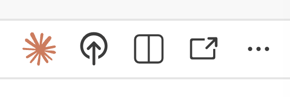{fig-align="center" width="45%" fig-alt="A screenshot of Positron with the Claude icon in the top-right corner of the editor." .lightbox}

:::

In the Claude panel, you may initially see various login options
(left screenshot below), but if you **simply wait**,
Claude should read your settings file,
and you should see a **prompt box** at the bottom of the Claude panel
(right screenshot below):

::: {.columns}
::: {.column width="43%"}

{fig-align="center" width="81%" fig-alt="A screenshot of the Claude Code panel showing a 'Not logged in' message and a 'Log in with API key' button." .lightbox}

:::
::: {.column width="57%"}

{fig-align="center" width="95%" fig-alt="A screenshot of the Claude Code panel ready for a first prompt." .lightbox}

:::
:::

<hr style="height:1pt; visibility:hidden;" />

::: {.columns}
::: {.column width="45%"}

To check that Claude works, type the following prompt in the box and press <kbd>Enter</kbd>:

> ***Write a horoscope for a dataset with 40% missing values***

If you get a horoscope back, Claude is set up correctly.

If you get an error instead, or Claude **merely keeps printing verbs** like "Brewing"
and "Deliberating" (Claude's variant on a spinning wheel) but nothing else,
let us know, and we'll help you troubleshoot.

:::
::: {.column width="55%"}

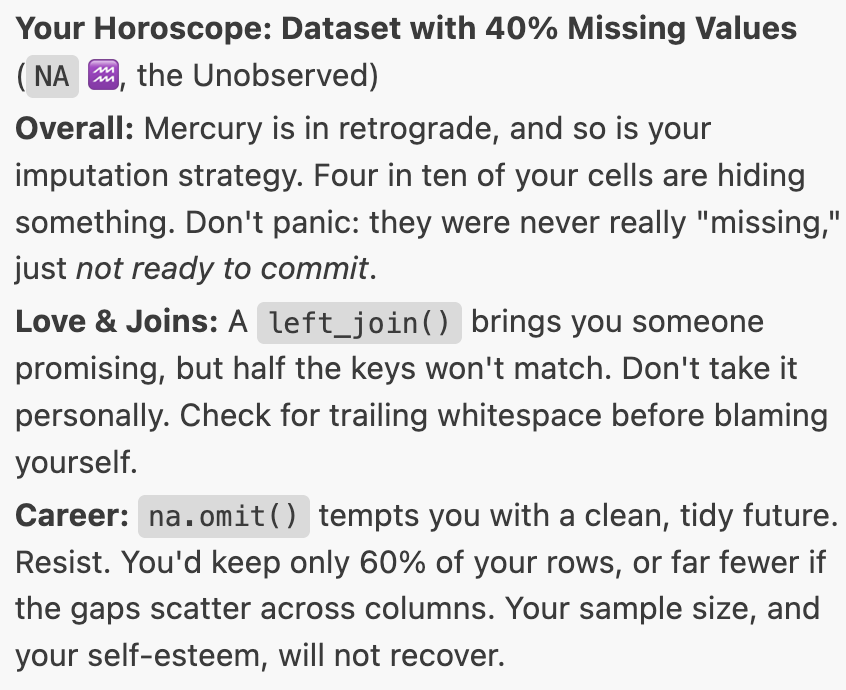{fig-align="center" width="85%" .no-border fig-alt="A screenshot of the Claude Code prompt box with a prompt asking for a horoscope for a dataset with 40% missing values." .lightbox}

:::
:::

## Basics of the interface

{fig-align="center" width="60%" .no-border fig-alt="A screenshot of the Claude Code prompt box, with buttons for adding files, the command menu, the model and effort level, and the permission mode." .lightbox}

The buttons across the bottom of the prompt box are, from left to right:

- **`+`** adds **files** as context to your prompt.

- **`/`** opens the **command menu**, with nearly all of Claude Code's options and settings.

- A **clock icon** with a number of minutes appears once Claude has responded
  (see [Start fresh often](#start-fresh)).

- **`Sonnet 5.5 Medium`** is the current **model** and **effort level**.
  Keep it at that, and don't select "_Default (recommended)_",
  which switches to the much more expensive Opus model.

- **`Manual`** is the current **permission mode** (what Claude is allowed to do
  without asking you first).

At the top of the Claude panel, there are buttons to see your **previous conversations**
(a different clock icon) and to start a **new conversation** (chat icon with a `+`).
We'll start a new conversation for each new task --- you'll see why [later](#start-fresh).

::: {.callout-note collapse="true"}
#### Permission modes _(Click to expand)_

Click on the permission mode to switch between modes:

- **Manual**: Claude asks permission for each file edit and for most commands
  (it runs simple read-only commands without asking).
- **Edit automatically**: Claude edits files without asking,
  but asks about running commands.
- **Auto**: a separate AI model checks each action,
  and Claude only asks you about risky ones.
- **Plan**: Claude only writes a plan, which you can review and modify
  before Claude carries it out. We'll try this in the mini-project.

We'll stick to **Manual** mode for most of today:
it's slower-going, but you'll see exactly what Claude does.
Once you're comfortable reviewing Claude's work,
the many permission requests can become tedious,
and it's easy to start clicking "Yes" without reading what you approve.
At that point, Auto mode is a good alternative.
:::

## A first example: a script for a single plot

### Ask Claude to write a script

Start a new conversation, and submit the following prompt:

> ***Write a script penguin-plot.R that makes a simple scatterplot of flipper length***
> ***vs. body mass for R's built-in penguins data, colored by species.***
> ***It should save the plot to penguins.png.***

Claude will show you what it's doing as it goes, and will **ask you for permission**
to create the script, showing you its proposed contents.
Take a quick look and accept it.

{fig-align="center" width="98%" .no-border fig-alt="A screenshot of Positron with the proposed contents of penguin-plot.R in the editor, and Claude asking for permission to create the file." .lightbox}

::: {.columns}
::: {.column}

Next, it may want to **run the script** to check that it works,
using a command like `Rscript penguin-plot.R`.
`Rscript` is a way to run an R script from the terminal rather than from the console.
Click **Yes** to let it run the command.
(On Windows, if Claude can't find `Rscript`, see [this box](#windows-rscript).)

:::
::: {.column}

{fig-align="center" width="90%" .no-border fig-alt="A screenshot of Claude asking for permission to run the script with Rscript." .lightbox}

:::
:::

::: {.columns}
::: {.column width="30%"}

Finally, it will print some kind of summary of what it's done:

:::
::: {.column width="70%"}

{fig-align="center" width="90%" .no-border fig-alt="A screenshot of Claude's summary of the script it wrote and ran." .lightbox}

:::
:::

::: {.columns}
::: {.column width="30%"}

You should see `penguins.png` in the file explorer on the left, and can click
on it to view it. Here's the plot I got:

:::
::: {.column width="70%"}

{fig-align="center" width="96%" .no-border fig-alt="A scatterplot of penguin flipper length vs. body mass, colored by species, with default ggplot2 styling." .lightbox}

:::
:::

Now, let's ask it to improve the plot, in the same conversation:

> ***Look at the plot you saved and suggest three improvements, then make them***

Claude will propose to make changes and present you with a "diff",
where deletions are highlighted in red and additions in green^[
The previous view, of the initial script, was also a diff,
but this wasn't as obvious because there were only additions.]:

{fig-align="center" width="70%" .no-border fig-alt="A screenshot of a diff of penguin-plot.R, with deleted lines in red and added lines in green." .lightbox}

Once you've approved its requests to edit the file and run the script,
look back at what is printed in the panel.
You should see that Claude **read the PNG file and looked at it** before suggesting
improvements: it can "see" images.
(More broadly, this is a big difference from chat-based AI:
Claude can check its own work, and iterate on it.)

{fig-align="center" width="70%" .no-border fig-alt="A screenshot of the Claude panel showing that Claude read the penguins.png file." .lightbox}

Here's what mine changed in a test run:

{fig-align="center" width="70%" .no-border fig-alt="A screenshot of Claude's summary of the three improvements it made to the plot." .lightbox}

Did you get similar changes? And here's the resulting plot:

{fig-align="center" width="75%" .no-border fig-alt="The improved penguin scatterplot, with a viridis color palette, point shapes by species, axis labels with units, a title, and the legend at the bottom." .lightbox}

Let's also take a look at the code in the script.
Is there anything you find striking or that you don't understand?
If so, ask Claude to explain it!
Is your code substantially different from mine?

<details><summary> &nbsp; Click to see the code I got</summary>

```{.R .file filename="penguin-plot.R"}
library(ggplot2)

# `penguins` is built into R (datasets package) as of R 4.5.0
n_complete <- sum(complete.cases(penguins[, c("body_mass", "flipper_len")]))

p <- ggplot(penguins, aes(x = body_mass, y = flipper_len, color = species, shape = species)) +
  geom_point(size = 2, alpha = 0.7, na.rm = TRUE) +
  scale_color_viridis_d(option = "D", end = 0.85) +
  scale_x_continuous(labels = scales::label_comma()) +
  labs(
    x = "Body mass (g)",
    y = "Flipper length (mm)",
    color = "Species",
    shape = "Species",
    title = "Penguin flipper length vs. body mass",
    subtitle = paste0("n = ", n_complete, " penguins with complete measurements")
  ) +
  theme_minimal() +
  theme(legend.position = "bottom")

print(p)
ggsave("penguins.png", p, width = 6, height = 4, dpi = 300)
```

</details>

Let's try one more:

> ***Make it look like a chart from The Economist***

Here's the plot I got:

{fig-align="center" width="70%" .no-border fig-alt="The penguin scatterplot restyled to look like a chart from The Economist, with a light blue-gray background, a bold title, and a small red tag in the top-left corner." .lightbox}

<details><summary> &nbsp; Click to see the code I got</summary>

```{.R .file filename="penguin-plot.R"}
library(ggplot2)
library(grid)

# `penguins` is built into R (datasets package) as of R 4.5.0
n_complete <- sum(complete.cases(penguins[, c("body_mass", "flipper_len")]))

# Economist-style palette and background
econ_bg <- "#D9E6EB"
econ_red <- "#E3120B"
econ_colors <- c(Adelie = "#006BA2", Chinstrap = "#E3120B", Gentoo = "#EBB434")

p <- ggplot(penguins, aes(x = body_mass, y = flipper_len, color = species, shape = species)) +
  geom_point(size = 2.2, alpha = 0.85, na.rm = TRUE) +
  scale_color_manual(values = econ_colors) +
  scale_x_continuous(labels = scales::label_comma()) +
  labs(
    x = "Body mass (g)",
    y = "Flipper length (mm)",
    title = "Big feet, big birds",
    subtitle = "Flipper length v body mass of penguins, by species",
    caption = paste0("Source: Palmer Station LTER; n = ", n_complete, " penguins"),
    color = NULL,
    shape = NULL
  ) +
  theme_minimal(base_size = 11) +
  theme(
    plot.background = element_rect(fill = econ_bg, color = NA),
    panel.background = element_rect(fill = econ_bg, color = NA),
    panel.grid.major.y = element_line(color = "white", linewidth = 0.6),
    panel.grid.major.x = element_blank(),
    panel.grid.minor = element_blank(),
    axis.line.x = element_line(color = "black", linewidth = 0.6),
    axis.ticks.x = element_line(color = "black", linewidth = 0.4),
    axis.ticks.length.x = unit(4, "pt"),
    axis.text = element_text(color = "grey25"),
    axis.title = element_text(color = "grey25", size = 9),
    plot.title = element_text(face = "bold", size = 15, margin = margin(b = 2)),
    plot.subtitle = element_text(size = 11, margin = margin(b = 8)),
    plot.caption = element_text(color = "grey35", size = 8, hjust = 0),
    plot.title.position = "plot",
    plot.caption.position = "plot",
    legend.position = "top",
    legend.justification = "left",
    legend.text = element_text(size = 10),
    plot.margin = margin(22, 14, 8, 10)
  )

# Draw the plot plus the Economist's red tag in the top-left corner
draw_plot <- function() {
  print(p)
  grid.rect(
    x = 0, y = 1, width = unit(0.07, "npc"), height = unit(0.012, "npc"),
    just = c("left", "top"), gp = gpar(fill = econ_red, col = NA)
  )
}

draw_plot()
png("penguins.png", width = 6, height = 4, units = "in", res = 300)
draw_plot()
invisible(dev.off())
```

</details>

::: {.callout-important}
#### Claude runs its own R

Claude does **not** use the R session in your Positron console.
When it runs a script, it starts a separate R process with `Rscript`,
which means that:

- Its plots don't appear in your **Plots** pane,
  and the objects it creates don't appear in your **Variables** pane.
- It can't see objects you created in the console.
  Anything it needs should be in a script or a file.

To see the results in Positron, simply run the script yourself.
:::

## File context and steering Claude

### Giving Claude your files as context

A key advantage of using AI inside your editor is that your files are readily available.
Your entire **workspace** (the folder you opened in Positron) is "implicit" context:
when Claude thinks it's useful, it will search and read files there by itself.

But when you have specific files in mind,
it's often better to point Claude to them **explicitly**.
That's faster and cheaper, and avoids Claude guessing which files you mean:

- **The file that's active in the editor** is added automatically:
  you can see its name below the prompt box^[Click the `x` to remove it.].
- You can also **select specific lines** in the active file, to focus Claude's attention on them.
- **Type `@`** followed by part of a file name to add any file in your workspace.
- To add **multiple files**, type `@` for each,
  or open each file in turn and press <kbd>Alt/Option</kbd>+<kbd>K</kbd>
  to insert a reference to it.

### Stopping, steering, and rewinding

Sometimes you need to adjust what Claude is doing while it's working:

- **Steer it**: type a new message while Claude is working,
  and it will take that into account after a few seconds.
  (It helps to **keep an eye on** Claude's intermediate messages!)
- **Stop it**: press <kbd>Esc</kbd> or click the stop button.
- **Rewind**: press <kbd>Esc</kbd> twice in quick succession,
  or hover over an earlier message and click the rewind button,
  to go back to an earlier point in the conversation and optionally undo file changes.
  (Claude is also good at undoing things when you simply ask it to.)

For example, triggering the rewind option after the 3-part conversation
about the penguin plot looks like this:

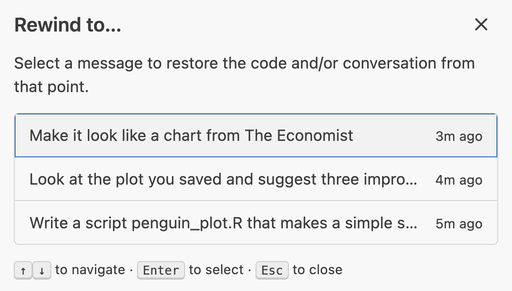{fig-align="center" width="60%" .no-border fig-alt="A screenshot of the rewind menu, listing earlier messages in the conversation to rewind to, with options to also restore the code." .lightbox}

## Persistent instructions with `CLAUDE.md`

### Persistent instructions: why and how

Each new conversation with Claude starts from scratch:
it doesn't see what you discussed in earlier conversations.
So you may find yourself repeatedly telling it the same things, such as
"never modify the raw data", "use the native pipe", or "don't use `setwd()`".

Instead, you can put these kinds of instructions in a file called `CLAUDE.md`,
a **Markdown** file that Claude **automatically reads** at the start of every conversation
in your project (if you're not familiar with Markdown,
you can simply consider it a plain text file when you write in it).
There is no required structure for its contents,
but it should be concise and easy to read, for you as well as for Claude.

As a first example,
create a new file `CLAUDE.md` in your project folder,
add the following line to it, and save it:

```{.markdown .file filename="CLAUDE.md"}
- Always answer like an overexcited sports commentator
```

Then, **close the file** (otherwise it would be added to your prompt as the active file,
and you couldn't tell whether Claude read it automatically),
start a **new conversation**, and ask:

> ***What's the difference between <- and = in R?***

Did Claude answer like an overexcited sports commentator? Then it read your `CLAUDE.md`!

### Our instructions for this project

Replace the sports commentator line with the following:

```{.markdown .file filename="CLAUDE.md"}
## R conventions

- Use paths relative to the project folder, and never use `setwd()`
- Use the tidyverse and the native pipe `|>`
- I'm an intermediate R user: prefer readable over clever code,
  and briefly explain non-obvious steps in comments
- Test R code by running it with `Rscript`, and Quarto documents with `quarto render`
- Ask before installing R packages
- Don't run Shiny apps yourself, since they keep running: I will run them
```

We're leaving out any information about our data here,
so we can see what Claude figures out by itself in the mini-project below.
In a real research project, though, it's worth adding sections
that briefly describe your data files, your project's file structure, and so on.
As another example, you may want all your plots to have a certain theme,
or to use a certain color palette, and you can put that in `CLAUDE.md` too.

::: {.columns}
::: {.column width="40%"}

Close the file again, and to check that Claude picks up the new instructions,
start a new conversation and ask:

> ***What rules should you follow in this project?***

The response I got is in the screenshot on the right.

:::
::: {.column width="60%"}

{fig-align="center" width="90%" .no-border fig-alt="A screenshot of Claude listing the rules from CLAUDE.md that it follows in this project." .lightbox}

:::
:::

We'll see these instructions in action in the mini-project below.

::: {#windows-rscript .callout-important collapse="true"}
#### Windows users: tell Claude where `Rscript` is _(Click to expand)_
On Windows, R's installer doesn't make `Rscript` available to commands run outside of R,
so Claude may struggle to find it.
To help it, run the following in the Positron console:

```{r}
normalizePath(file.path(R.home("bin"), "Rscript.exe"), winslash = "/")
```

And add the resulting path to the "R conventions" section of your `CLAUDE.md`, e.g.:

```{.markdown .file filename="CLAUDE.md (excerpt)"}
- Rscript is at `C:/Program Files/R/R-4.5.1/bin/Rscript.exe`
```

If you run into this problem in the first example, before you've created a `CLAUDE.md`,
simply paste the path into your prompt for now.

<hr style="height:1pt; visibility:hidden;" />
:::

::: {.callout-note collapse="true"}
#### More on using `CLAUDE.md` _(Click to expand)_

**Drafting a `CLAUDE.md` with `/init`**\
Instead of writing a `CLAUDE.md` from scratch, you can type `/init` in the prompt box:
Claude then looks through your project and drafts a `CLAUDE.md` for you to review and edit.
This can be a useful start in a larger existing project,
but the most valuable parts of a `CLAUDE.md` are things only you know:
what the project is about, where the data is, and how you want things done.

**Keep updating your `CLAUDE.md`**\
Start simple, and add to it whenever you notice yourself telling Claude the
same thing again, or Claude making the same mistake again.
Keep it short, though: it's read at the start of every conversation,
so it uses up tokens (and money) each time.

**Instructions are not strict rules**\
Claude will usually, but not always, follow the instructions in `CLAUDE.md`.

**Claude's memory**\
Claude also keeps **memory** notes for itself:
when you correct it or tell it about your preferences, it _may_ save a note,
which is loaded into future conversations in the same project.
Type `/memory` in the prompt box to see and edit these.
:::

## Mini-project: from a messy CSV to a report and an app

We'll work with the "factbook" data from the previous session,
World Bank data that is now in `factbook.csv`.
We'll have Claude clean it,
and then build a report and an app on top of the cleaned data.

### A quick look at the data

First, let's take a quick look at the data:
click on `factbook.csv` in the Explorer pane to open it in the Data Explorer.

{fig-align="center" width="95%" .no-border fig-alt="A screenshot of the Data Explorer showing the factbook.csv file." .lightbox}

Scroll around, including to the bottom of the file,
and you'll see a few things that make the data awkward to work with:

- It is in a "wide" format, with one column per year.
- The year column names, like `2000 [YR2000]`, are not just numbers.
- The year columns are text rather than numbers,
  because missing values are coded as `..`.
- The last rows are not data, but empty rows and notes about the database.

Let's see how Claude handles this.

::: {.callout-tip appearance="simple"}
We'll start a **new conversation** for each step below.
Thanks to the `CLAUDE.md` file and the files Claude creates along the way,
it doesn't need to remember the previous conversation.
:::

### Clean the data

> ***Write clean-factbook.R that reads factbook.csv and saves a tidy version***
> ***to factbook_tidy.csv with columns country, country_code, indicator,***
> ***year (numeric), and value. Check the result.***

Data cleaning is less "easy to check" than the other tasks today:
mistakes can be silent.
So it's worth looking carefully at both the code and the result.
Some things to watch for in its reply, the code, and the resulting `factbook_tidy.csv`:

- How does Claude look at the data before writing code?
- Did it figure out the `..` missing values and the odd year column names by itself?
- Did it notice the notes at the bottom of the file, which aren't data?
  (Check the last rows of the tidy file.)
- How did it "check the result"?
- Is the code clear and does it have explanatory comments?

{fig-align="center" width="80%" .no-border fig-alt="A screenshot of the Data Explorer showing the factbook_tidy.csv file." .lightbox}

Let's ask for one follow-up change, in the same conversation:

> ***Add a continent column***

It's likely that Claude will want to use the `countrycode` package to do this,
and following our `CLAUDE.md` instructions,
it will ask for permission to install the package first:

{fig-align="center" width="60%" fig-alt="A screenshot of Claude asking whether to install the countrycode package to add continents, or to add them from its own knowledge instead." .lightbox}

Let's take another quick look at the data in the Data Explorer,
to see if the continent column looks right.

<details><summary> &nbsp; Click to see the final version of the script I got</summary>

```{.R .file filename="clean-factbook.R"}
library(tidyverse)
library(countrycode)

# Read everything as character first, because the `..` missing-value
# code would otherwise turn the year columns into text anyway
factbook <- read_csv("factbook.csv", col_types = cols(.default = "c"))

factbook_tidy <- factbook |>
  # The file ends with blank and footnote rows that have no country: remove them
  filter(!is.na(`Country Code`)) |>
  # Drop the series code; keep the readable indicator name
  select(
    country = `Country Name`,
    country_code = `Country Code`,
    indicator = `Series Name`,
    starts_with("20")
  ) |>
  # Wide -> long: one row per country x indicator x year
  pivot_longer(
    cols = starts_with("20"),
    names_to = "year",
    values_to = "value"
  ) |>
  mutate(
    # Column names look like "2000 [YR2000]": keep the first 4 characters
    year = as.numeric(str_sub(year, 1, 4)),
    # `..` marks missing values: turn into NA, then convert to numbers
    value = as.numeric(na_if(value, "..")),
    # Look up the continent from the ISO3 country code; Kosovo (XKX) and the
    # Channel Islands (CHI) have no standard match, so we set them manually
    continent = countrycode(
      country_code,
      origin = "iso3c",
      destination = "continent",
      custom_match = c(XKX = "Europe", CHI = "Europe")
    ),
    .after = country_code
  )

write_csv(factbook_tidy, "factbook_tidy.csv")
```
</details>

### A Quarto report with *gt* tables

The [*gt*](https://gt.rstudio.com/){target="_blank"} package ("grammar of tables")
lets you build tables from data frames, much like ggplot2 does for plots.
A report with nicely formatted tables is a good example of a
"hard to write, easy to check" task.
Things like color-coded cells or a small trend plot in each row of a *gt* table
take many lines of code with options you'd probably have to look up every time,
but one look at the rendered table tells you whether it worked.

This is a bigger task, so we'll first ask Claude for a **plan**.
Start a new conversation, click on the permission mode, and select **Plan** mode.
Then, submit:

> ***Create a Quarto report report.qmd that summarizes how countries changed between***
> ***2000 and 2015, using factbook_tidy.csv. Include 3-4 ggplot figures,***
> ***a gt table of the 10 countries with the largest growth in GDP per capita,***
> ***with color-coded cells and a small plot of the trend in each row,***
> ***and a short narrative for each section.***
> ***Make the plots and table attractive but also readable.***
> ***Render the report to HTML and fix any errors.***

Claude will explore the files and then present a plan as a Markdown document.
Take a look at the plan.
For example, how did Claude interpret "largest growth in GDP per capita":
in dollars or in percent?

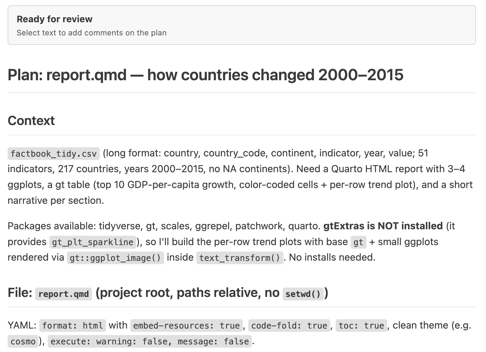{fig-align="center" width="85%" fig-alt="A screenshot of the plan that Claude wrote for the Quarto report." .lightbox}

::: {.columns}
::: {.column}

If you want to **change** anything, you can leave comments in the plan or provide
feedback in the Claude Code panel, either in the "Tell Claude what to do instead" box
or by clicking "No, keep planning" and asking Claude to revise the plan
(top screenshot on the right).

For example, I noticed in the plan above that Claude implied the table could
turn out better with *gtExtras*,
but that it wouldn't use it because it wasn't installed.
So I said "No, keep planning" and asked it to install the package and use it
(bottom screenshot on the right).

When you're happy with the plan, **approve** it,
choosing the option to approve edits **automatically**, and let Claude get to work.
When it's done, open `report.html` (e.g. right-click it in the Explorer and
open it in the Viewer, or in your browser).

:::
::: {.column}

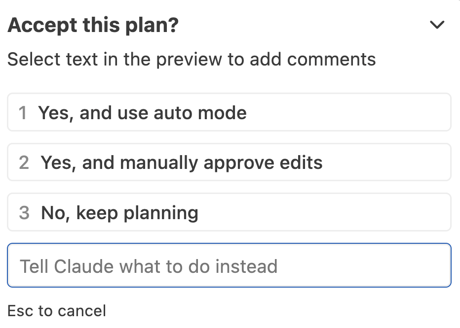{fig-align="center" width="90%" fig-alt="A screenshot of the options to approve Claude's plan, keep planning, or tell Claude what to do instead." .lightbox}

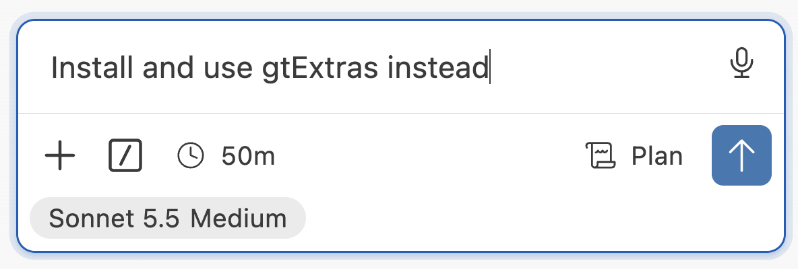{fig-align="center" width="90%" .no-border fig-alt="A screenshot of feedback asking Claude to install and use the gtExtras package." .lightbox}

:::
:::

Let's look through the report. Are the plots and the table sensible?
Below are some screenshots of the report I got, but your report may look different.

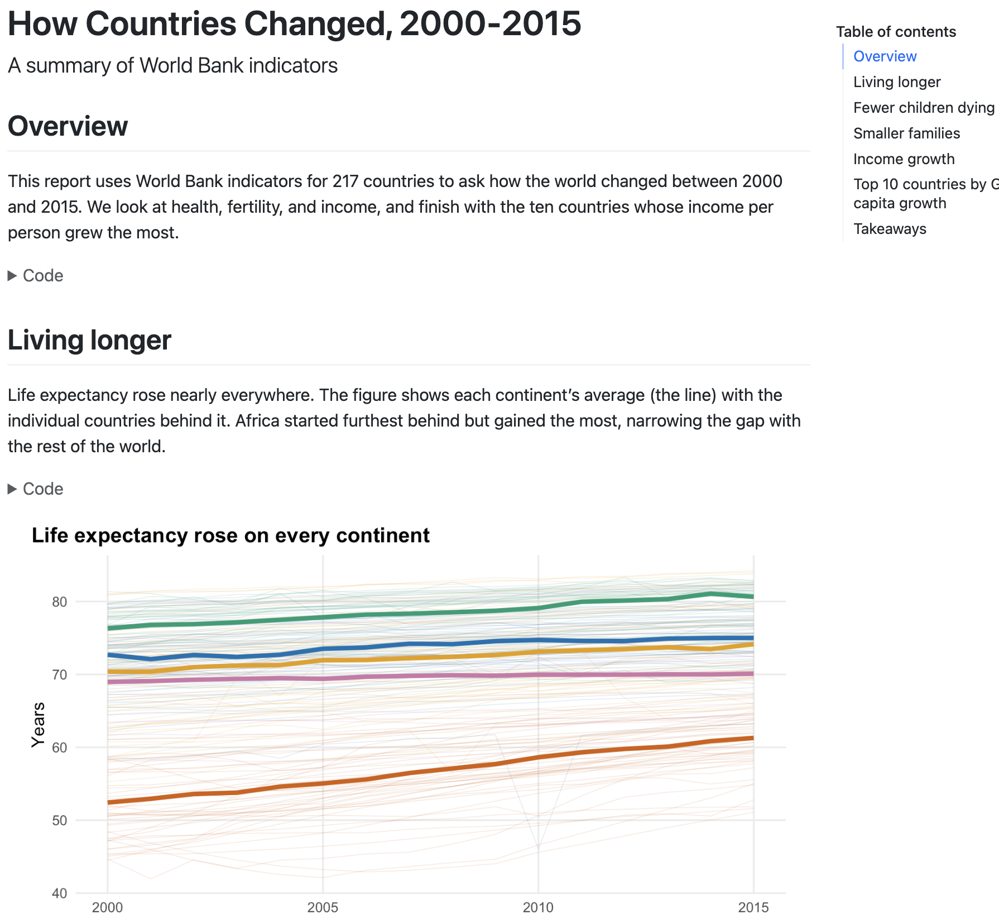{fig-align="center" width="90%" .no-border fig-alt="A screenshot of the top of the rendered Quarto report." .lightbox}

::: {.panel-tabset}

## Table -- version 1

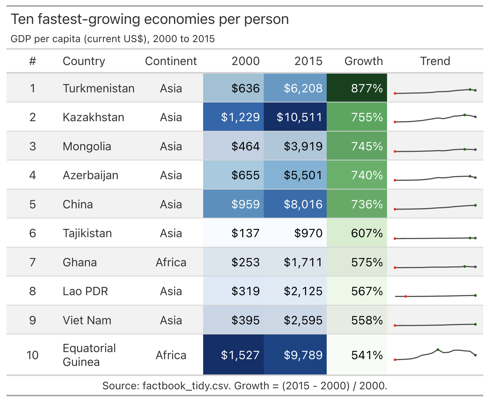{fig-align="center" width="95%" .no-border fig-alt="A gt table of the ten countries with the largest growth in GDP per capita from 2000 to 2015, with blue-shaded GDP cells, green-shaded growth cells, and a small trend line in each row." .lightbox}

## Table -- version 2

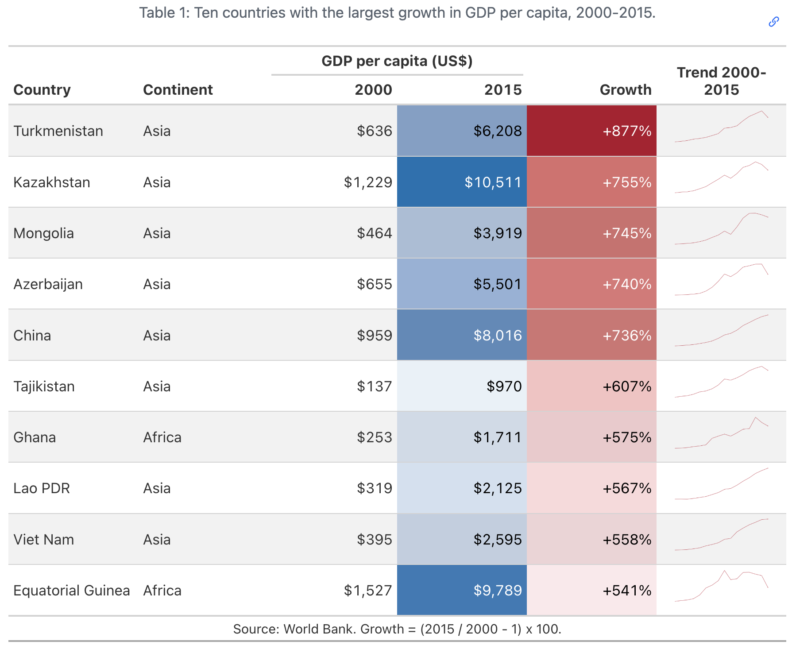{fig-align="center" width="95%" .no-border fig-alt="A gt table of the ten countries with the largest growth in GDP per capita from 2000 to 2015, with blue-shaded 2015 GDP cells, red-shaded growth cells, and a small trend line in each row." .lightbox}

:::

::: {.panel-tabset}

## Plot ex. 1

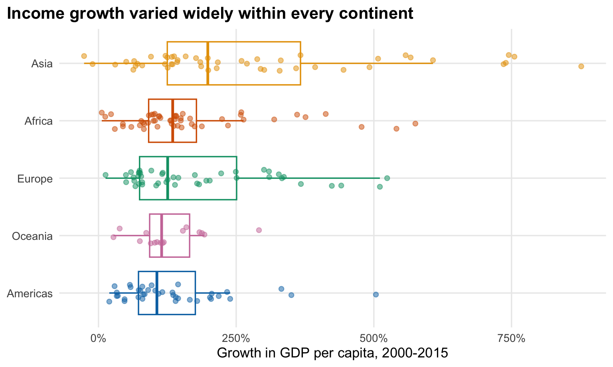{fig-align="center" width="90%" .no-border fig-alt="Boxplots with jittered points of the growth in GDP per capita from 2000 to 2015 by continent, titled 'Income growth varied widely within every continent'." .lightbox}

## Plot ex. 2

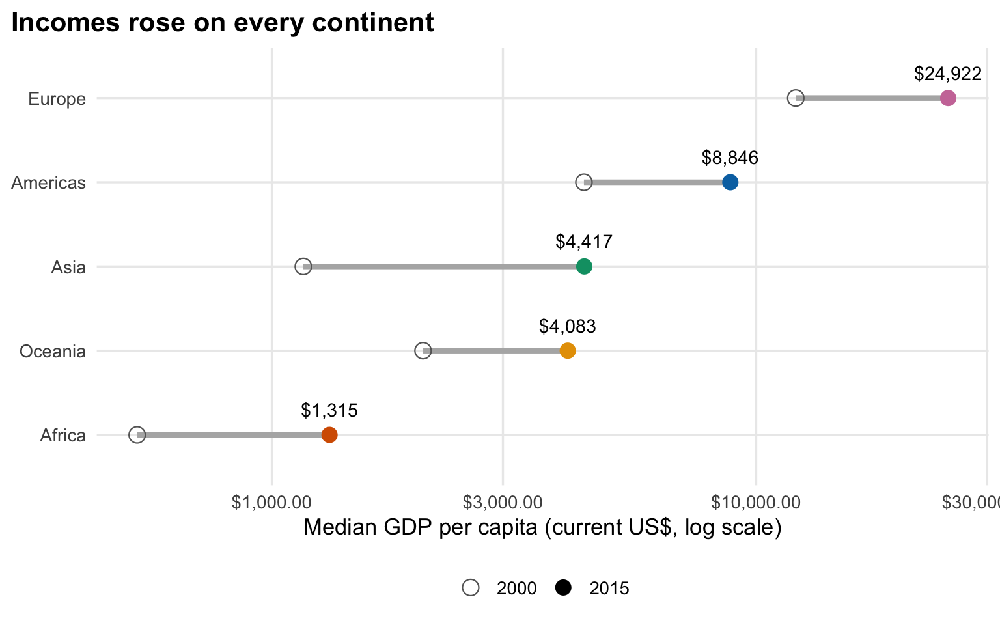{fig-align="center" width="90%" .no-border fig-alt="A dumbbell plot of median GDP per capita by continent in 2000 and 2015, on a log scale, titled 'Incomes rose on every continent'." .lightbox}

## Plot ex. 3

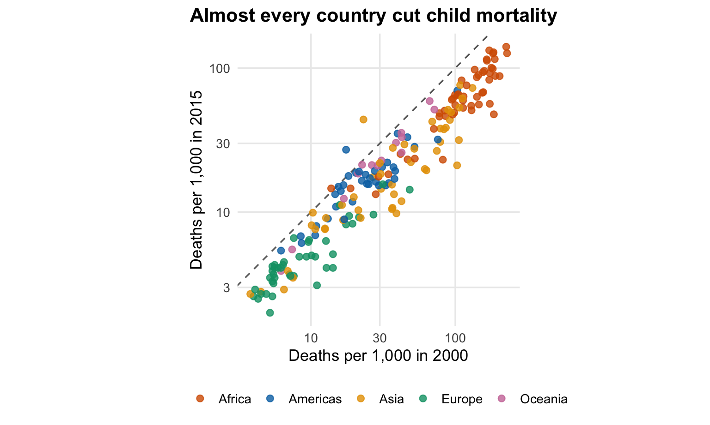{fig-align="center" width="90%" .no-border fig-alt="A scatterplot of child mortality in 2015 vs. 2000 on log scales, colored by continent, with a dashed line of no change, titled 'Almost every country cut child mortality'." .lightbox}

## Plot ex. 4

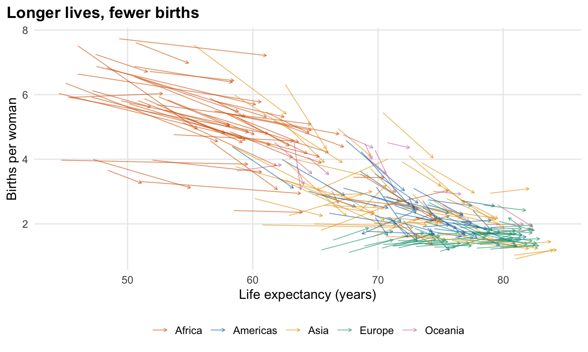{fig-align="center" width="90%" .no-border fig-alt="Arrows showing each country's change in life expectancy and births per woman from 2000 to 2015, colored by continent, titled 'Longer lives, fewer births'." .lightbox}

## Plot ex. 5

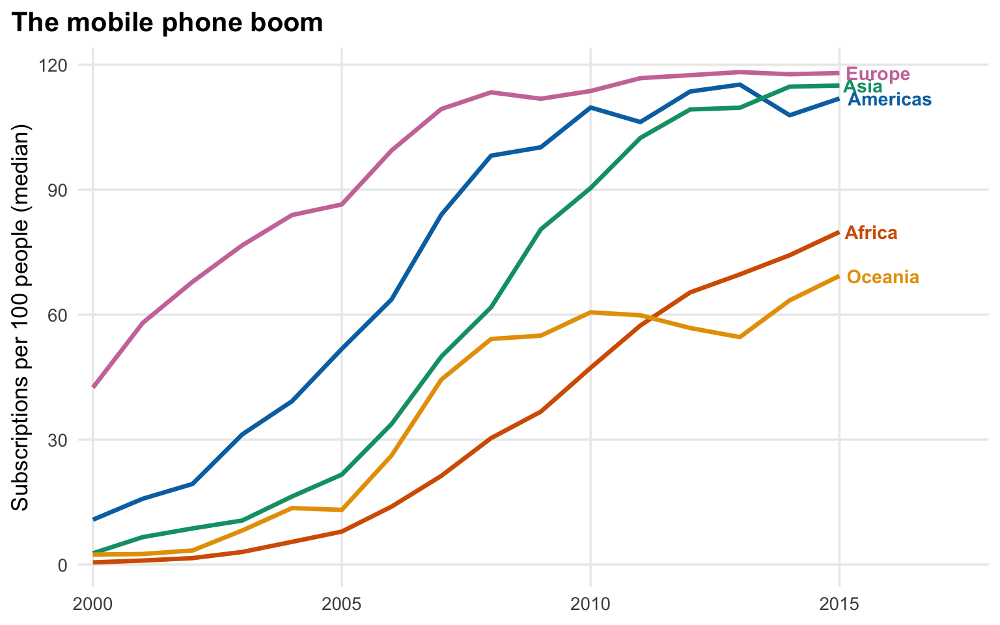{fig-align="center" width="90%" .no-border fig-alt="A line plot of median mobile phone subscriptions per 100 people by continent from 2000 to 2015, titled 'The mobile phone boom'." .lightbox}

:::

Finally, let's ask Claude for a change in the same conversation.
I will go with interactive plots, but you can ask for any change you like.
Interactive plots are another good fit:
packages like ggiraph have their own functions and options you'd otherwise
have to learn, while checking the result only takes some hovering and clicking.

> ***Make one of the plots interactive with ggiraph, adding tooltips and hover effects***

(As with `countrycode`, Claude should first ask to install `ggiraph`.)

For me, Claude made the life expectancy plot interactive.
Hover over a point to see the country's values,
and to highlight all countries on the same continent:

```{r}
#| eval: true
#| code-fold: true
#| code-summary: "Show the code"
#| warning: false
#| message: false
library(tidyverse)
library(ggiraph)

factbook <- read_csv("factbook_tidy.csv")

# One colour-blind-safe colour per continent
continent_cols <- c(
  Africa = "#D55E00",
  Americas = "#0072B2",
  Asia = "#009E73",
  Europe = "#CC79A7",
  Oceania = "#E69F00"
)

# One row per country with the 2000 and 2015 life expectancy
life <- factbook |>
  filter(
    indicator == "Life expectancy at birth, total (years)",
    year %in% c(2000, 2015)
  ) |>
  select(country, continent, year, value) |>
  pivot_wider(names_from = year, values_from = value, names_prefix = "y") |>
  drop_na(y2000, y2015) |>
  mutate(
    tip = str_glue(
      "{country} ({continent})\n2000: {round(y2000, 1)} years\n2015: {round(y2015, 1)} years\nGain: {round(y2015 - y2000, 1)} years"
    )
  )

p_life <- ggplot(life, aes(y2000, y2015, colour = continent)) +
  geom_abline(
    slope = 1,
    intercept = 0,
    linetype = "dashed",
    colour = "grey40"
  ) +
  # data_id = continent: hovering one country highlights its whole continent
  geom_point_interactive(
    aes(tooltip = tip, data_id = continent),
    alpha = 0.8,
    size = 2.2
  ) +
  scale_colour_manual(values = continent_cols, name = NULL) +
  labs(
    title = "Almost every country gained years of life",
    subtitle = "Dashed line = no change",
    x = "Life expectancy in 2000 (years)",
    y = "Life expectancy in 2015 (years)"
  ) +
  theme_minimal(base_size = 13) +
  theme(
    plot.title = element_text(face = "bold"),
    plot.title.position = "plot",
    panel.grid.minor = element_blank(),
    legend.position = "bottom"
  )

girafe(
  ggobj = p_life,
  width_svg = 8,
  height_svg = 5,
  options = list(
    opts_hover(css = "fill-opacity:1; stroke-opacity:1; stroke-width:2px;"),
    opts_hover_inv(css = "opacity:0.2;"),
    opts_tooltip(
      css = "background:white; color:#222; padding:6px 8px;
                        border-radius:4px; box-shadow:0 1px 4px #0006;"
    )
  )
)
```

::: exercise
####  Exercise: Ohio State branding with a `_brand.yml` {-}

[brand.yml](https://posit-dev.github.io/brand-yml/){target="_blank"} is a format
to define your organization's colors, fonts, and logos in a single file, `_brand.yml`,
which Quarto (and Shiny) then use to style your documents.

A `_brand.yml` is **automatically used by Quarto** to define the **overall** look
(fonts, colors of headings and links) of the report,
but it (understandably) won't style the plots and tables according to brand colors ---
that's where Claude comes in.

Download [this `_brand.yml` for Ohio State](osu_brand.yml){download="_brand.yml"}
and save it in your `codeclub-claude` folder as `_brand.yml`
(rename it if your browser saved it as `osu_brand.yml`).
Alternatively, create the file yourself and paste in the contents from the box below.
Then, have a look at the file.

<details><summary>  &nbsp; Click to see the contents of \_brand.yml</summary>

```{.yaml .file filename="_brand.yml"}
# A _brand.yml for Ohio State-styled Quarto documents and Shiny apps
# Colors follow OSU's brand palette; fonts are freely available Google Fonts
# stand-ins for OSU's Buckeye Sans/Serif

meta:
  name:
    short: Ohio State
    full: The Ohio State University
  link: https://www.osu.edu

color:
  palette:
    scarlet: "#BA0C2F"
    gray: "#A7B1B7"
    dark-gray: "#3F4443"
    light-gray: "#F2F2F2"
    black: "#212325"
    white: "#FFFFFF"
  foreground: black
  background: white
  primary: scarlet
  secondary: dark-gray
  light: light-gray
  dark: dark-gray

typography:
  fonts:
    - family: Source Sans 3
      source: google
      weight: [400, 600, 700]
      style: [normal, italic]
    - family: Source Serif 4
      source: google
      weight: [600, 700]
    - family: Source Code Pro
      source: google
  base:
    family: Source Sans 3
    line-height: 1.5
  headings:
    family: Source Serif 4
    weight: 700
    color: scarlet
  monospace: Source Code Pro
  link:
    color: scarlet
```
</details>

The Ohio State colors are quite limiting, consisting only of scarlet and shades of gray,
so they may not work well for all plots and tables ---
hence the "where appropriate" hedge in the prompt below.
In a new conversation, ask Claude:

> ***Use the colors from @_brand.yml in the plots and tables of @report.qmd where appropriate***

This is a good place to practice with adding files as context using `@`:

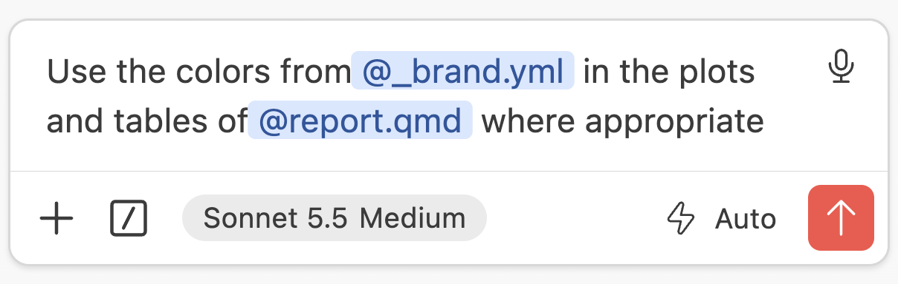{fig-align="center" width="60%" .no-border fig-alt="A screenshot of the Claude prompt box with _brand.yml and report.qmd added as context with @." .lightbox}

Then, check how it did!

<details><summary>  &nbsp; Click to see what I got</summary>

Probably for the best, Claude decided to keep its main color palette the way it was,
but use Ohio State colors for plot titles, labels, and so on:

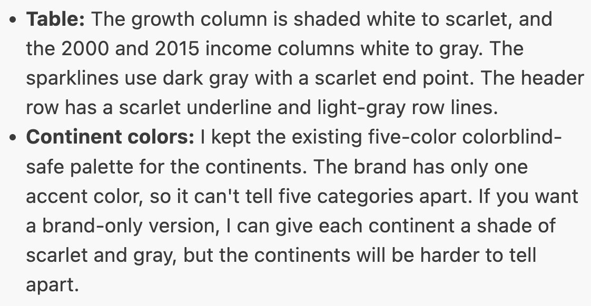{fig-align="center" width="60%" .no-border fig-alt="A screenshot of Claude's summary of how it applied the Ohio State colors to the report." .lightbox}

I don't think the branded report necessarily looks better,
but you may want or need to use your institution's branding anyway:

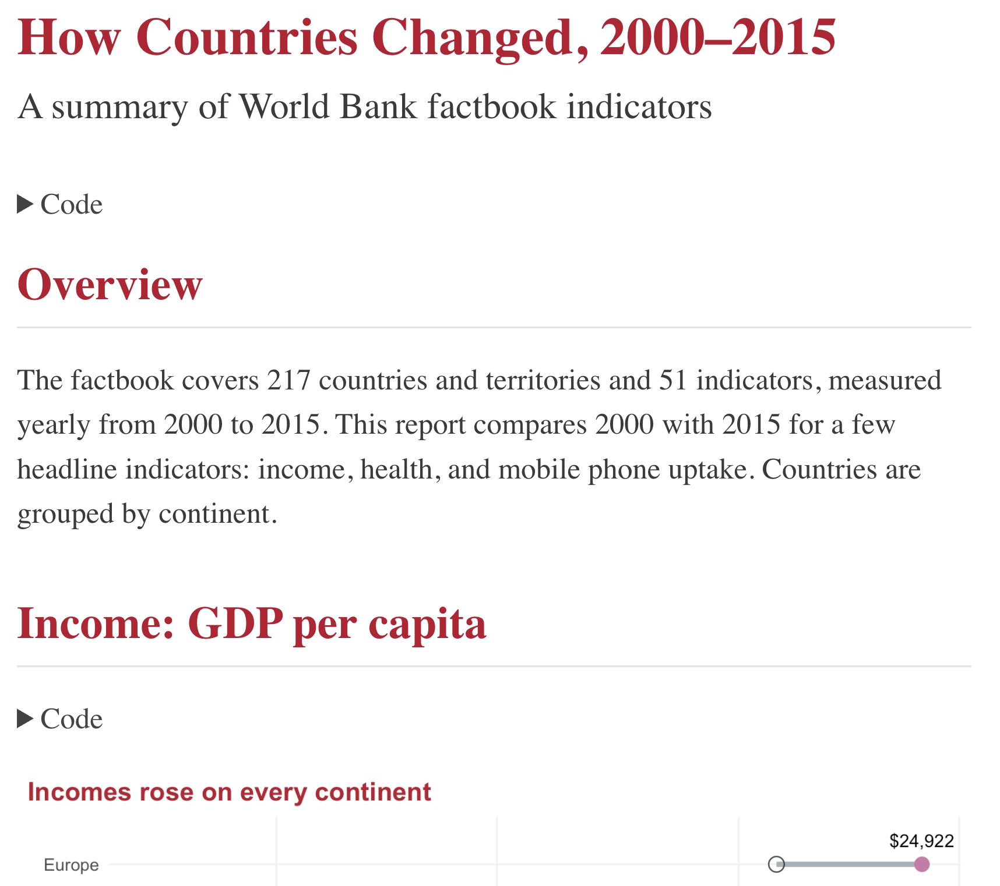{fig-align="center" width="90%" fig-alt="A screenshot of the Quarto report with Ohio State branding, with scarlet headings." .lightbox}

At any rate, the table came out quite nicely:

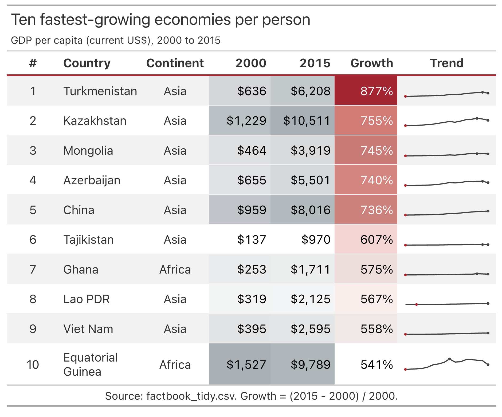{fig-align="center" width="90%" .no-border fig-alt="A screenshot of the gt table in the report with Ohio State branding." .lightbox}

</details>

:::

::: {.callout-note collapse="true"}
#### Having Claude create a `_brand.yml` _(Click to expand)_

So how do you get a `_brand.yml` in the first place?
You can just ask Claude! For example:

> ***Create a \_brand.yml for Ohio State, using scarlet #BA0C2F and gray #A7B1B7***

Or point it to your lab's or organization's style guide (e.g., a PDF).
:::

### A small Shiny app

[Shiny](https://shiny.posit.co/){target="_blank"} lets you build interactive web apps
(dropdowns, sliders, plots and tables that update as you click)
using only R or Python code.
Shiny apps are perhaps the best example of a "hard to write, easy to check" task:
they need a lot of boilerplate code with an unusual "reactive" logic
that many people find hard to learn and rarely write often enough to remember.
But to check the result,
you just run the app and click around to see whether it does what you want.

Now that you've seen what Claude asks permission for, let's try **Auto** mode,
where Claude only asks about risky actions.
In a new conversation, set the permission mode to **Auto**, and submit:

> ***Create a small Shiny app app.R using bslib and our \_brand.yml, where I can pick***
> ***a country and an indicator, and see a line plot over 2000-2015 and a wide-format gt table***
> ***of the values. Keep it under 100 lines.***

Because of our `CLAUDE.md` instruction, Claude should not try to run the app itself.
Instead, open `app.R` and click the **Run App** button at the top of the editor:
the app will open in Positron's Viewer pane.
It may look something like this:

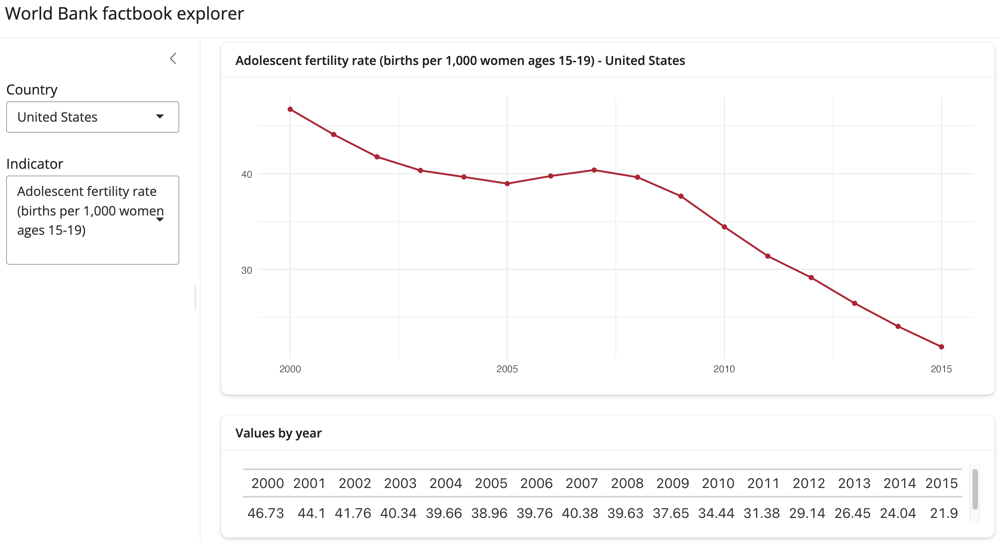{fig-align="center" width="90%" .no-border fig-alt="A screenshot of the Shiny app." .lightbox}

If you have time, ask for a follow-up change:

> ***Add the option to select a second country to compare against***

Also try to "break" the app:
pick a country and indicator combination for which there is no data. What happens?
If the app shows an error or an empty plot, ask Claude to handle this better.

### More ideas to try

#### With this data

Some other examples of good tasks for Claude Code that are not too expensive:

- **Parameterized report**:
  "Turn report.qmd into a one-page country profile with the country as a parameter,
  and render it for Ghana, Peru, and Armenia"
- **Slides**:
  "Turn the report into a short Quarto revealjs slide deck with the same branding"
- **Translate code**:
  "Rewrite this to use base R code instead" or "Translate R code to Python"
- **A map**:
  "Using factbook_tidy.csv, make a world map of life expectancy in 2015, colored by country"
- **Code review**:
  "Review clean-factbook.R for bugs, unclear code, and hard-coded values"
- **README**:
  "Write a README.md that explains what this project does and how to reproduce the results"

#### Other

Not for now, but here are some other things you can try with Claude Code:

- Troubleshoot your code, software installations, and so on
- Turn your code into a package
- Document your code or write a tutorial based on your code
- Make a personal or professional website
- Draft Methods bullet points from code
- Review Word documents: Claude can read _and_ edit Word documents,
  and it can do so with Tracked Changes and leave comments, just like a human reviewer.
  You can also add so-called "skills" to Claude, such as ones to review scientific
  manuscripts ([example repo](https://github.com/k-dense-ai/scientific-agent-skills){target="_blank"}).

## Appendix {#managing-context-and-cost}

### Agents fill up the context window quickly

A model's **context window** holds everything in the conversation,
and performance degrades as it fills up.
With an agent, this happens much faster than with a chatbot:
every file Claude reads and every command output it sees goes into the context too.
To see how full the context window is, type **`/context`** in the prompt box.

### Start fresh often {#start-fresh}

Today, we've started a **new conversation** for each new task.
That's a good habit:
Claude can get confused when you switch topics within a conversation,
and a long conversation is slower and more expensive,
because with every new prompt, the _entire_ conversation is sent to the model again.

To make re-sending the conversation cheaper,
the part that hasn't changed since the previous turn is **cached**,
and cached tokens cost only about one tenth of the regular price.
However, with an API key like ours, the cache **expires** after only **5 minutes**
without activity --- the clock icon in the prompt box shows how much time is left.
After that, your next message reprocesses the entire conversation at the full price.
So when you come back to a long conversation after a break,
consider starting a new one instead.

If you do want to continue a long conversation, type **`/compact`** in the prompt box:
Claude then replaces the conversation so far with a summary, which frees up context.

### Cost

Every token costs money, and your API key has a limited budget.
To see an **estimate** of what the current conversation has cost so far,
type `/usage` in the prompt box.

To keep costs down:

- Stick to **Sonnet** at **Medium** effort (the default in your settings file).
- **Start fresh** for each new task, and point Claude to specific files.
- Don't ask Claude to "read" or "analyze" large data files:
  have it write code that does the analysis instead.
- For general questions, like explaining a concept or a function,
  a browser-based chat (e.g. Gemini or Copilot through your OSU account)
  works just as well and doesn't use your API key's budget.

### Good habits when working with an agent

#### Getting good help {-}

- **Be explicit.** Point Claude to the relevant files, and put your conventions and rules
  in `CLAUDE.md`.
- **Start fresh** for each new task, and keep conversations focused.
- **Use Plan mode** for bigger tasks, and review the plan before Claude starts.

#### Checking and keeping the results {-}

- **You own the result.** Read every proposed edit and command before approving it.
- **Verify, don't trust.** When Claude says something "works", that may be a prediction
  rather than a test result. Run the code yourself, and check results independently.
- **Results should come from code you can rerun.** Let Claude help you write code that you
  review, run, and keep; don't rely on numbers or conclusions it only reports in the chat.
- **Commit before, review after.** Use Git so that you can see and undo what Claude changed
  (Positron's Source Control view makes this easy).
- **Keep a record** of how you used AI, which journals increasingly ask you to disclose
  (see the box below).

::: {.callout-note collapse="true"}
#### Documenting your AI use _(Click to expand)_

**Save your conversations**\
Claude saves your conversations automatically, but not in your project,
and in a format that's not easy to read.
To save a conversation in your project as a plain-text file,
type `/export` in the prompt box.

**Let Claude keep a diary**\
For a concise overview, you can let Claude keep a diary of key findings and decisions,
by adding something like this to your `CLAUDE.md`:

```{.markdown .file filename="CLAUDE.md (excerpt)"}
## AI diary

- After completing a task, add an entry at the bottom of `doc/ai-diary.md`
  with the date, what I asked for, which files you created or changed,
  and any key decisions (including alternatives that were rejected)
- Keep entries short
```
:::

::: exercise
####  Bonus exercise: Fix a script {-}

The script `penguin-summary.R` should compute the number of penguins and their
mean body mass, for Adelie and Gentoo penguins, but it has **two** problems.

<details><summary> &nbsp; Click to see the script's code</summary>

```{.R .file filename="penguin-summary.R"}
# Summarize body mass for Adelie and Gentoo penguins
# (uses the penguins data that is built into R 4.5.0 and later)

library(tidyverse)

# Keep only Adelie and Gentoo penguins
two_species <- penguins |>
  filter(species == c("Adelie", "Gentoo"))

# Number of penguins and mean body mass per species
two_species |>
  group_by(species) |>
  summarize(
    n = n(),
    mean_mass_g = mean(body_mass)
  )
```

</details>

1. Download [the script](penguin-summary.R){download="penguin-summary.R"}
   and save it in your `codeclub-claude` folder.

2. Open the script and run it. What's wrong with the output?

   <details><summary> &nbsp; Click to see the output</summary>

   ```bash-out-solo
   # A tibble: 2 × 3
     species     n mean_mass_g
     <fct>   <int>       <dbl>
   1 Adelie     76       3407.
   2 Gentoo     62         NA
   ```

   </details>

3. Start a new conversation, and with the script open, ask Claude:

   > ***Explain what this script does***

   Does its explanation match your own understanding?

   It may well have pointed out one or two problems with the script,
   and if it did, it may have offered to fix them.
   If so, affirm that you want it to fix the problem(s) it found.

4. In case Claude didn't note the problem that produces the `NA` in the output, ask:

   > ***I ran this and the mean body mass for Gentoo is NA. Fix it.***

   It should be able to identify and fix this problem,
   and if it hadn't already fixed the other problem, it may fix that too.

5. Run the script yourself. If the results are like this, the problems are fixed:

   ```bash-out-solo
   # A tibble: 2 × 3
     species     n mean_mass_g
     <fct>   <int>       <dbl>
   1 Adelie    152       3701.
   2 Gentoo    124       5076.
   ```

   If not, ask Claude to look for another problem.

<details><summary>  Click here for the solution</summary>

The script contains two errors:

- `mean()` returns `NA` when there are any missing values, unless you use `na.rm = TRUE`.
  This is easy to spot, because the output contains an `NA`.

- `species == c("Adelie", "Gentoo")` does not check whether `species` is one of these two values.
  Instead, R "recycles" the two-element vector along all rows,
  comparing row 1 to `"Adelie"`, row 2 to `"Gentoo"`, row 3 to `"Adelie"`, and so on.
  As a result, about **half** of the Adelie and Gentoo penguins are silently dropped.
  The fix is to use `%in%` instead of `==`.

The second error is the more dangerous one, because it **silently** produces wrong results:
there is no error or warning, and the output looks plausible.
Before the fix, the script reports 76 Adelie and 62 Gentoo penguins,
whereas there are 152 and 124.

```{r}
two_species <- penguins |>
  filter(species %in% c("Adelie", "Gentoo"))

two_species |>
  group_by(species) |>
  summarize(
    n = n(),
    mean_mass_g = mean(body_mass, na.rm = TRUE)
  )
```

Did Claude catch the second error?
It may have noticed it while reading the script, after running it and seeing
suspicious counts, or not at all.
This shows why code that runs without errors still needs to be checked,
whether you or Claude wrote or fixed it.

</details>
:::

<hr style="height:1pt; visibility:hidden;" />
