------------------------------------------------------------------------

<br>

## Introduction

### What we'll cover

In the [previous session](../S12E02_plotting_01/index.qmd),
we used AI through Posit Assistant and GitHub Copilot in Positron
to help you make plots.
Today, we'll use a different kind of AI tool: **Claude Code**, Anthropic's
"agentic" coding tool, which we'll run inside Positron.

We'll start small, by having Claude write a script for a single plot,
and work our way up to tasks that would take you quite a while by yourself:
cleaning up a messy dataset, writing a Quarto report with plots and nicely
formatted tables, giving it Ohio State branding, and building a small Shiny app.
Specifically, we'll cover:

- **Setting up Claude Code** in Positron with an OSU API key
- **Having Claude write, run, and check R code**
- **Your files as context**, and letting Claude find and fix bugs
- **Persistent instructions** with a `CLAUDE.md` file
- **A mini-project**: from a messy CSV to a branded Quarto report and a Shiny app
- **Managing context and cost**, and good habits when working with an agent

### From chat to agents

When you use AI through a browser-based chat,
the model can't see your files unless you paste or upload them,
and it can't check whether the code it writes actually works.
**AI agents** remove those limitations. Working inside your editor, they can:

- **Read** the files in your project, so you don't have to explain or paste them
- **Edit and create** files, showing you each change for approval
- **Run code and commands**, and then **look at the results**,
  including errors and even the plots they made
- _Hack HuggingFace_ [😱]{style="font-size:1.2em;"}

### Posit Assistant vs. Claude Code

Posit Assistant, which we used in the previous session, is also an agent.
In fact, it has a key built-in strength that Claude Code does not have:
it is connected to your **live R session**, so it can can see your objects and
run code in your console^[
Positron does make it possible to expose the same functionality for Claude Code,
but that requires some setup and I have not yet tried that.].

On the other hand, Claude Code has the edge in ther areas:

- It is a **general-purpose** coding agent and is better at longer-running,
  multi-step tasks.
- It is a more **mature product** overall. Specifically, in Positron,
  we've experienced issues with authentication both via GitHub and an API key,
  that we have not with Claude Code.

(Claude Code also comes in other forms, like a command-line program and a desktop app.
Here, we'll use its VS Code extension in Positron.)

### Authentication with an API key

Rather than using a personal account,
we'll authenticate through an API key from OSU's
[Generative AI Service ](https://it.osu.edu/generative-ai-service){target="_blank"},
which is **approved for use with restricted institutional data (S2--S4)**.

(As implied above, Positron Assistant also allows API key authentication,
but its authentication sometimes acts up,
and we didn't want to risk technical problems for this session.)

We'll give you a **personal API key** for this session with limited credit.
If you'd like to continue using Claude Code or Positron Assistant in this manner
after today's Code Club, you'll have to set this up via the link above ---
but keep in mind that it isn't free,
so you're PI (or similar) would need to have funds that can be used for this purpose.

Alternatively or additionally,
you could consider getting a personal Anthropic subscription.
Per token, this is a _lot_ cheaper than usage with an API key,
but you'll need to pay personally _and_ you shouldn't use it with institutional data.

## Getting set up

### First installations

If you haven't done so already, please:

1. **Install Positron** and **R version 4.5.0 or higher** ---
   see the [Positron session](../S12E01_positron_01/index.qmd#before-we-start) for details.
   (We'll use the `penguins` data that is built into R since version 4.5.0.)

2. **Install [Quarto](https://quarto.org/docs/get-started/){target="_blank"}**.
   Positron comes with its own copy of Quarto,
   but Claude can't find that copy when it runs commands,
   so it needs a regular Quarto installation to render documents.

3. **Install the R packages** we'll use:

   ```{r}
   install.packages("tidyverse")
   install.packages("gt")
   install.packages("countrycode")
   install.packages("shiny")
   install.packages("bslib")
   ```

::: {.callout-note collapse="true"}
#### Windows users: Git for Windows (optional) _(Click to expand)_
On Windows, Claude Code runs commands with PowerShell by default.
If you have [Git for Windows](https://git-scm.com/downloads/win){target="_blank"} installed,
it will use Git Bash instead, which is what it does on Mac and Linux.
Both work for today, so there's no need to install Git for Windows just for this session.
:::

### Download and open the project folder

1. Download [this zip file](codeclub-claude.zip) and unzip it.
   You may want to move the resulting `codeclub-claude` folder into a folder for Code Club,
   e.g. `Documents/codeclub/codeclub-claude`.

2. Open the `codeclub-claude` folder in Positron with `File` > `Open Folder...`,
   and trust the folder when asked.

The folder contains the following files:

```bash-out-solo
codeclub-claude
├── data
│   └── factbook.csv        # World Bank data from the previous session
└── R
    └── penguin_summary.R   # A script with some problems...
```

::: {.callout-note appearance="simple"}
Claude treats the folder that is open in Positron as its "**workspace**":
this is where it will look for files,
and by default the only place where it can make changes.
:::

### Install the Claude Code extension

1. In the **Extensions** view in the Activity Bar, search for "claude",
   and click **Install** for the extension "**Claude Code for VS Code**" by Anthropic.

   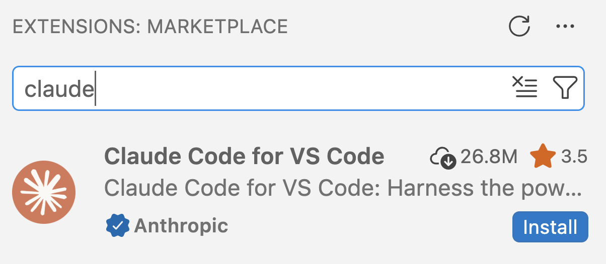{fig-align="center" width="50%" fig-alt="A screenshot of the VS Code Extensions side bar showing the Claude Code for VS Code extension by Anthropic with an Install button." .lightbox}

2. If asked whether you trust the publisher "Anthropic",
   click **Trust Publisher & Install**.

   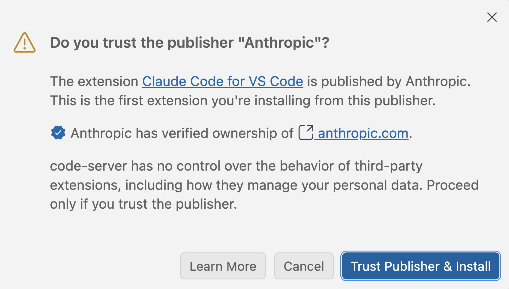{fig-align="center" width="55%" fig-alt="A screenshot of a pop-up asking 'Do you trust the publisher Anthropic?' with a 'Trust Publisher & Install' button." .lightbox}

### Connect Claude to your API key

To tell Claude to use your API key,
you need a **settings file** called `settings.json` in a folder `.claude` in your Home folder.
Claude reads this file every time it starts up.

Let's set this up:

1. Create the folder and the (empty) file, and open the file in the editor,
   by copying the code below into the Positron **console** and pressing <kbd>Enter</kbd>
   ^[All of this can also be done without code, in a perhaps more intuitive way,
   but the interface will differ between computers, so this is less likely to fail here]:

   ```{r}
   # Get your Home folder (on Windows, R's "~" points to Documents instead)
   home <- if (.Platform$OS.type == "windows") {
     Sys.getenv("USERPROFILE")
   } else {
     path.expand("~")
   }

   # Create the .claude folder and the settings file
   # (an existing settings file is left alone)
   settings_file <- file.path(home, ".claude", "settings.json")
   dir.create(dirname(settings_file), showWarnings = FALSE)
   if (!file.exists(settings_file)) file.create(settings_file)

   # Open the file in the editor
   file.edit(settings_file)
   ```

2. Paste the following contents into the file that opened in the editor:

   ```{.json .file filename="&#126;/.claude/settings.json"}
   {
     "env": {
       "ANTHROPIC_BASE_URL": "https://litellm.cloud.osu.edu",
       "ANTHROPIC_AUTH_TOKEN": "API-KEY",
       "ANTHROPIC_DEFAULT_OPUS_MODEL": "claude-opus-5-5",
       "ANTHROPIC_DEFAULT_SONNET_MODEL": "claude-sonnet-5",
       "ANTHROPIC_DEFAULT_HAIKU_MODEL": "claude-haiku-5-5",
       "CLAUDE_CODE_DISABLE_EXPERIMENTAL_BETAS": "1"
     },
     "model": "sonnet",
     "effortLevel": "medium",
     "outputStyle": "Concise",
     "theme": "auto"
   }
   ```

3. **Replace the placeholder** `API-KEY` with your personal API key
   as shown below, and save the file:

   ```{.file filename="&#126;/.claude/settings.json (excerpt - with fictional API key)"}
       "ANTHROPIC_AUTH_TOKEN": "bY-7jiuWbfck9DZk34hA_t",
   ```

::: {.callout-note collapse="true"}
#### More about the settings file _(Click to expand)_

The file is in JSON format, a plain-text format with key-value pairs:
a colon `:` separates each key from its value, pairs are separated by commas,
and curly braces `{}` group pairs.
A single missing quote or comma breaks the whole file
(this would be a likely culprit if Claude doesn't pick up your API key).

- `ANTHROPIC_BASE_URL` makes Claude go through OSU's service rather than
  directly to Anthropic.
- `ANTHROPIC_AUTH_TOKEN` is the API key.
- The `MODEL` lines specify which model versions to use.
- `model` and `effortLevel` set the default model (Sonnet) and effort level (Medium).
- `outputStyle` makes Claude's answers shorter and more to the point
  (remove this line if you prefer longer explanations).
:::

::: {.callout-important collapse="true"}
#### Treat the API key like a password _(Click to expand)_
Anyone with your key can use it, and usage costs money and depletes your key's budget.
So never share your key or commit it to a Git repository.
That's one reason the settings file is located in your Home folder,
and not in a project folder that others may see.
:::

### Open Claude

::: {.columns}
::: {.column width="70%"}

Open Claude Code by clicking the orange "splash" **Claude icon**
in the top-right corner of the editor.
This opens Claude as a **tab in the editor**^[
  You can also open it in the secondary side bar on the right,
  but that's already busy with the Variables, Plots, and Help panes,
  so I like to keep Claude in the editor.],
by default side-by-side with scripts and other files.

In the Claude Panel, you may initially see various login options
(left screenshot below), but if you **simply wait**,
Claude should read your settings file,
and you should see a **prompt box** at the bottom of the Claude tab
(right screenshot below):

:::
::: {.column width="30%"}

{fig-align="center" width="90%" fig-alt="A screenshot of the top-right of the VS Code editor pane, with the orange Claude icon encircled." .lightbox}

:::
:::

::: {.columns}
::: {.column width="43%"}

{fig-align="center" width="81%" fig-alt="A screenshot of the Claude Code panel showing a 'Not logged in' message and a 'Log in with API key' button." .lightbox}

:::
::: {.column width="57%"}

{fig-align="center" width="95%" fig-alt="A screenshot of the Claude Code panel ready for a first prompt." .lightbox}

:::
:::

To check that Claude works, type the following prompt in the box and press <kbd>Enter</kbd>:

> ***Write a horoscope for a dataset with 40% missing values***

If you get a horoscope back, Claude is set up correctly.

If you get an error instead, or it **merely keeps printing verbs** like "Brewing"
and "Deliberating" (Claude's variant on a spinning wheel) but nothing else,
let us know, and we'll help you troubleshoot.

## Basics of the interface

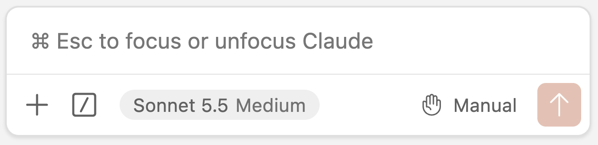{fig-align="center" width="60%" .no-border fig-alt="A screenshot of the Claude Code prompt box." .lightbox}

The buttons across the bottom of the prompt box are, from left to right:

- **`+`** adds **files** as context to your prompt.

- **`/`** opens the **command menu**, with nearly all of Claude Code's options and settings.

- A **clock icon** with a number of minutes appears once Claude has responded
  (see the [section on cost](#managing-context-and-cost)).

- **`Sonnet 5 Medium`** is the current **model** and **effort level**.
  Keep it at that, and don't select "_Default (recommended)_",
  which switches to the much more expensive Opus model.

- **`Manual`** is the current **permission mode** (what Claude is allowed to do
  without asking you first).

At the top of the Claude tab, there are buttons to see your **previous conversations**
(clock icon) and to start a **new conversation** (chat icon with a `+`).
We'll start a new conversation for each new task --- you'll see why [later](#start-fresh).

::: {.callout-note collapse="true"}
#### Permission modes _(Click to expand)_

Click on the permission mode to switch between modes:

- **Manual**: Claude asks permission for each file edit and for most commands
  (it runs simple read-only commands without asking).
- **Edit automatically**: Claude edits files without asking,
  but asks about running commands.
- **Auto**: a separate AI model checks each action,
  and Claude only asks you about risky ones.
- **Plan**: Claude only writes a plan, which you can review and modify
  before Claude carries it out. We'll try this in the mini-project.

We'll stick to **Manual** mode for most of today:
it's slower-going, but you'll see exactly what Claude does.
Once you're comfortable reviewing Claude's work,
the many permission requests can become tedious,
and it's easy to start clicking "Yes" without reading what you approve.
At that point, Auto mode is a good alternative.
:::

## A first example: a single plot

### Ask Claude to write a script

Start a new conversation, and submit the following prompt:

> ***Write a script penguin_plot.R that makes a simple scatterplot of flipper length***
> ***vs. body mass for R's built-in penguins data, colored by species.***
> ***It should print the plot and save it to penguins.png.***

Claude will show you what it's doing as it goes, and will **ask you for permission**
to create the script, showing you its proposed contents.
Take a quick look and accept it.

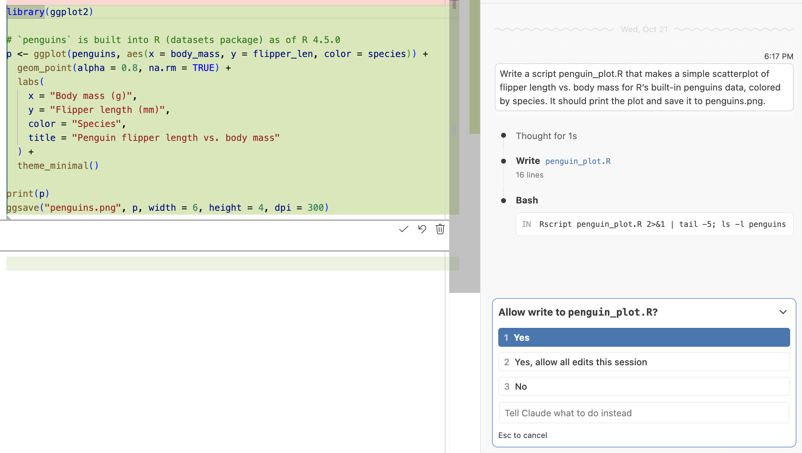{fig-align="center" width="85%" .no-border fig-alt="A screenshot of the Claude Code prompt box." .lightbox}

Next, it may want to **run the script** to check that it works,
using a command like `Rscript penguin_plot.R`.
`Rscript` is a way to run an R script from the terminal (rather than from the console).
Click **Yes** to let it run the command.

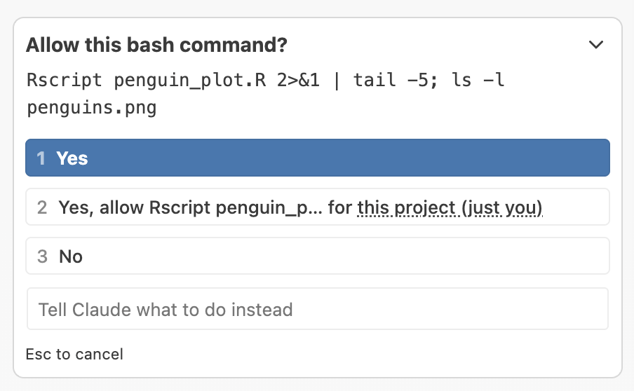{fig-align="center" width="50%" .no-border fig-alt="A screenshot of the Claude Code prompt box." .lightbox}

Finally, it will print some kind of summary of what it's done:

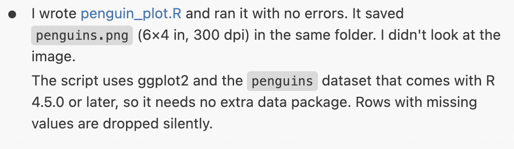{fig-align="center" width="65%" .no-border fig-alt="A screenshot of the Claude Code prompt box." .lightbox}

Here's the plot I got:

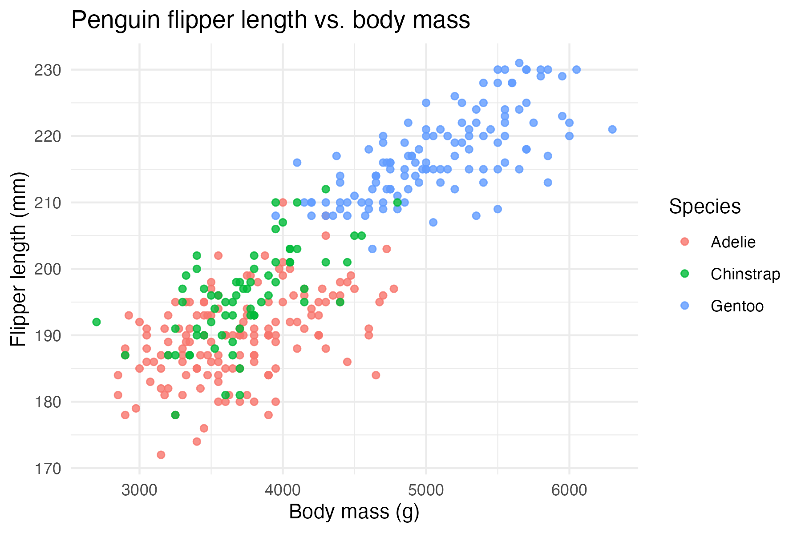{fig-align="center" width="70%" .no-border fig-alt="A screenshot of the Claude Code prompt box." .lightbox}

Now, let's ask it to improve the plot, in the same conversation:

> ***Look at the plot you saved and suggest three improvements, then make them***

Claude will propose to make changes and present you with a "diff",
where deletions are in highlighted in red and additions in green^[
The previous view, of the initial script, was also a diff,
but this wasn't as obvious because there were only additions]:

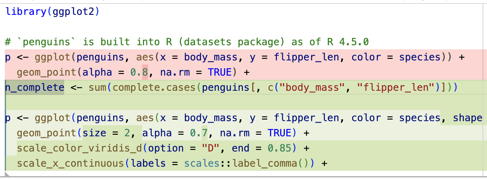{fig-align="center" width="60%" .no-border fig-alt="A screenshot of the Claude Code prompt box." .lightbox}

Once you've approved its requests of editing the file and running the script,
look back at what is printed in the panel.
You should see that Claude **read the PNG file and looked at it** before suggesting
improvements: it can "see" images.
(More broadly, this is a big difference from chat-based AI:
Claude can check its own work, and iterate on it.)

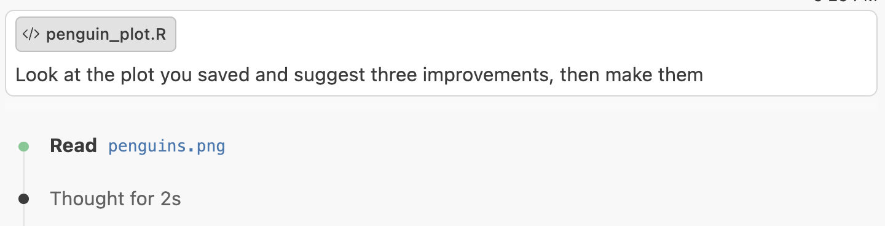{fig-align="center" width="70%" .no-border fig-alt="A screenshot of the Claude Code prompt box." .lightbox}

Here's what mine changed in a test-run:

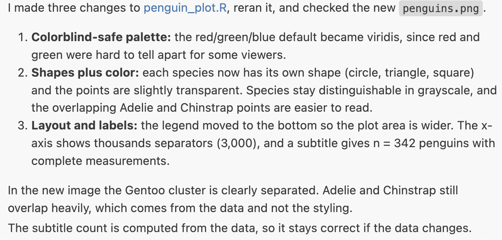{fig-align="center" width="70%" .no-border fig-alt="A screenshot of the Claude Code prompt box." .lightbox}

Did you get similar changes?

Here's the plot I got:

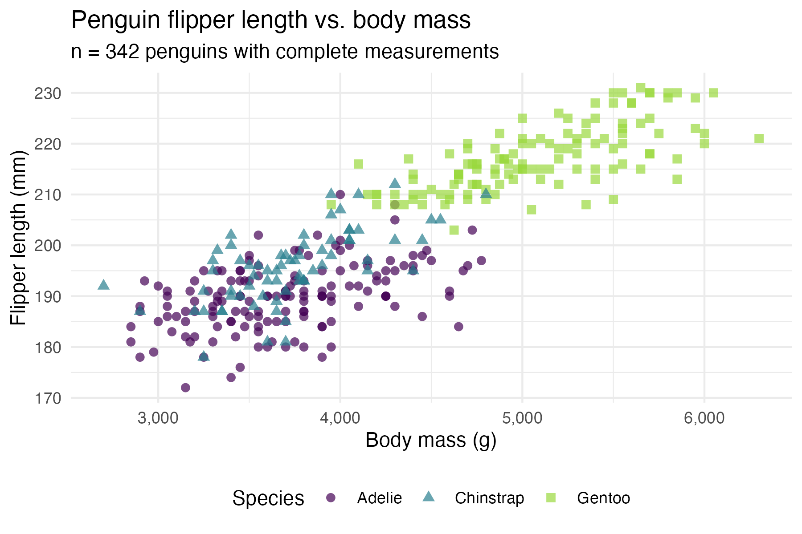{fig-align="center" width="70%" .no-border fig-alt="A screenshot of the Claude Code prompt box." .lightbox}

Let's also take a look at the code in the script.
Is there anything you find striking or that you don't understand?
Is your code substantially different from mine?

<details><summary>Click to see the code I got</summary>

```{.R .file filename="penguin_plot.R"}
library(ggplot2)

# `penguins` is built into R (datasets package) as of R 4.5.0
n_complete <- sum(complete.cases(penguins[, c("body_mass", "flipper_len")]))

p <- ggplot(penguins, aes(x = body_mass, y = flipper_len, color = species, shape = species)) +
  geom_point(size = 2, alpha = 0.7, na.rm = TRUE) +
  scale_color_viridis_d(option = "D", end = 0.85) +
  scale_x_continuous(labels = scales::label_comma()) +
  labs(
    x = "Body mass (g)",
    y = "Flipper length (mm)",
    color = "Species",
    shape = "Species",
    title = "Penguin flipper length vs. body mass",
    subtitle = paste0("n = ", n_complete, " penguins with complete measurements")
  ) +
  theme_minimal() +
  theme(legend.position = "bottom")

print(p)
ggsave("penguins.png", p, width = 6, height = 4, dpi = 300)
```

</details>

Let's try one more:

> ***Make it look like a chart from The Economist***

Here's the plot I got:

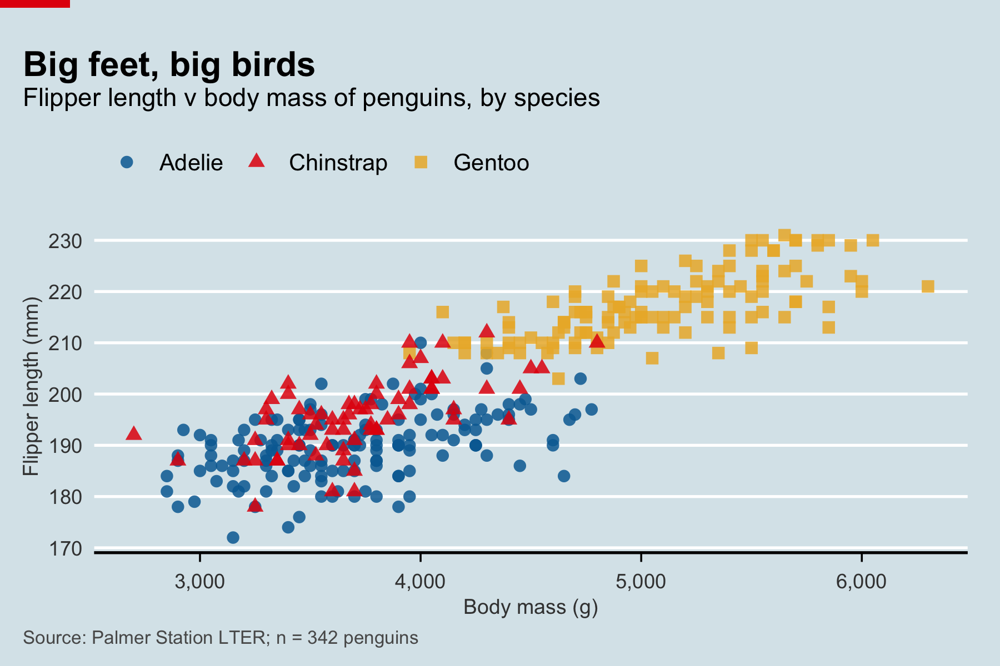{fig-align="center" width="70%" .no-border fig-alt="A screenshot of the Claude Code prompt box." .lightbox}

<details><summary>Click to see the code I got</summary>

```{.R .file filename="penguin_plot.R"}
library(ggplot2)
library(grid)

# `penguins` is built into R (datasets package) as of R 4.5.0
n_complete <- sum(complete.cases(penguins[, c("body_mass", "flipper_len")]))

# Economist-style palette and background
econ_bg <- "#D9E6EB"
econ_red <- "#E3120B"
econ_colors <- c(Adelie = "#006BA2", Chinstrap = "#E3120B", Gentoo = "#EBB434")

p <- ggplot(penguins, aes(x = body_mass, y = flipper_len, color = species, shape = species)) +
  geom_point(size = 2.2, alpha = 0.85, na.rm = TRUE) +
  scale_color_manual(values = econ_colors) +
  scale_x_continuous(labels = scales::label_comma()) +
  labs(
    x = "Body mass (g)",
    y = "Flipper length (mm)",
    title = "Big feet, big birds",
    subtitle = "Flipper length v body mass of penguins, by species",
    caption = paste0("Source: Palmer Station LTER; n = ", n_complete, " penguins"),
    color = NULL,
    shape = NULL
  ) +
  theme_minimal(base_size = 11) +
  theme(
    plot.background = element_rect(fill = econ_bg, color = NA),
    panel.background = element_rect(fill = econ_bg, color = NA),
    panel.grid.major.y = element_line(color = "white", linewidth = 0.6),
    panel.grid.major.x = element_blank(),
    panel.grid.minor = element_blank(),
    axis.line.x = element_line(color = "black", linewidth = 0.6),
    axis.ticks.x = element_line(color = "black", linewidth = 0.4),
    axis.ticks.length.x = unit(4, "pt"),
    axis.text = element_text(color = "grey25"),
    axis.title = element_text(color = "grey25", size = 9),
    plot.title = element_text(face = "bold", size = 15, margin = margin(b = 2)),
    plot.subtitle = element_text(size = 11, margin = margin(b = 8)),
    plot.caption = element_text(color = "grey35", size = 8, hjust = 0),
    plot.title.position = "plot",
    plot.caption.position = "plot",
    legend.position = "top",
    legend.justification = "left",
    legend.text = element_text(size = 10),
    plot.margin = margin(22, 14, 8, 10)
  )

# Draw the plot plus the Economist's red tag in the top-left corner
draw_plot <- function() {
  print(p)
  grid.rect(
    x = 0, y = 1, width = unit(0.07, "npc"), height = unit(0.012, "npc"),
    just = c("left", "top"), gp = gpar(fill = econ_red, col = NA)
  )
}

draw_plot()
png("penguins.png", width = 6, height = 4, units = "in", res = 300)
draw_plot()
invisible(dev.off())
```

::: {.callout-important}
#### Claude runs its own R

Claude does **not** use the R session in your Positron console.
When it runs a script, it starts a separate R process with `Rscript`,
which means that:

- Its plots don't appear in your **Plots** pane,
  and the objects it creates don't appear in your **Variables** pane.
- It can't see objects you created in the console.
  Anything it needs should be in a script or a file.

To see the results in Positron, simply run the script yourself.
:::

## Your files as context

### Your workspace is the context

A key advantage of using AI inside your editor is that your files are readily available.
Your entire **workspace** (the folder you opened in Positron) is "implicit" context:
when Claude thinks it's useful, it will search and read files there by itself.

But when you have specific files in mind,
it's often better to point Claude to them **explicitly**.
That's faster and cheaper, and avoids Claude guessing which files you mean:

- **The file that's active in the editor** is added automatically:
  you can see its name below the prompt box^[Click the `x` to remove it.].
- You can also **select specific lines** in the active file, to focus Claude's attention on them.
- **Type `@`** followed by part of a file name to add any file in your workspace.
- To add **multiple files**, type `@` for each,
  or press <kbd>Alt/Option</kbd>+<kbd>K</kbd> with a file active in the editor.

### Letting Claude find and fix bugs

::: exercise
####  Exercise: Fix a script {-}

The script `penguin_summary.R` should compute the number of penguins and their
mean body mass, for Adelie and Gentoo penguins, but it has **two** problems.

<details><summary>Click to see the script's code</summary>

```{.R .file filename="penguin_summary.R"}
# Summarize body mass for Adelie and Gentoo penguins
# (uses the penguins data that is built into R 4.5.0 and later)

library(tidyverse)

# Keep only Adelie and Gentoo penguins
two_species <- penguins |>
  filter(species == c("Adelie", "Gentoo"))

# Number of penguins and mean body mass per species
two_species |>
  group_by(species) |>
  summarize(
    n = n(),
    mean_mass_g = mean(body_mass)
  )
```

</details>

1. Open the script and run it. What's wrong with the output?

   <details><summary>Click to see the output</summary>

   ```bash-out-solo
   # A tibble: 2 × 3
   species     n mean_mass_g
   <fct>   <int>       <dbl>
   1 Adelie     76       3407.
   2 Gentoo     62         NA
   ```

   </details>

2. Start a new conversation, and with the script open, ask Claude:

   > ***Explain what this script does***

   Does its explanation match your own understanding?

   It may well have pointed out one or two problems with the script,
   and if it did, it may have proposed to fix it if.
   If so, affirm that you want it to fix the problem(s) it found.

3. In case Claude didn't note the problem that produces the `NA` in the output, ask:

   > ***I ran this and the mean body mass for Gentoo is NA. Fix it.***

   It should be able to identify and fix this problem,
   and if it hadn't already fixed the other problem, it may fix that too.

4. Run the script yourself. If the results are like this, the problems are fixed:

   ```bash-out-solo
   # A tibble: 2 × 3
   species     n mean_mass_g
   <fct>   <int>       <dbl>
   1 Adelie    152       3701.
   2 Gentoo    124       5076.
   ```

   If not, press it on detecting another potential problem.

<details><summary>  Click here for the solution</summary>

The script contains two errors:

- `mean()` returns `NA` when there are any missing values, unless you use `na.rm = TRUE`.
  This is easy to spot, because the output contains an `NA`.

- `species == c("Adelie", "Gentoo")` does not check whether `species` is one of these two values.
  Instead, R "recycles" the two-element vector along all rows,
  comparing row 1 to `"Adelie"`, row 2 to `"Gentoo"`, row 3 to `"Adelie"`, and so on.
  As a result, about **half** of the Adelie and Gentoo penguins are silently dropped.
  The fix is to use `%in%` instead of `==`.

The second error is the more dangerous one, because it **silently** produces wrong results:
there is no error or warning, and the output looks plausible.
Before the fix, the script reports 76 Adelie and 62 Gentoo penguins,
whereas there are 152 and 124.

```{r}
two_species <- penguins |>
  filter(species %in% c("Adelie", "Gentoo"))

two_species |>
  group_by(species) |>
  summarize(
    n = n(),
    mean_mass_g = mean(body_mass, na.rm = TRUE)
  )
```

Did Claude catch the second error?
It may have noticed it while reading the script, after running it and seeing
suspicious counts, or not at all.
This shows why code that runs without errors still needs to be checked,
whether you or Claude wrote or fixed it.

</details>
:::

### Stopping, steering, and rewinding

Sometimes you need to adjust what Claude is doing while it's working:

- **Steer it**: type a new message while Claude is working,
  and it will take that into account after a few seconds.
  (It helps to **keep an eye on** Claude's intermediate messages!)
- **Stop it**: press <kbd>Esc</kbd> or click the stop button.
- **Rewind**: press <kbd>Esc</kbd> twice in quick succession,
  or hover over an earlier message and click the rewind button,
  to go back to an earlier point in the conversation and optionally undo file changes.
  (Claude is also good at undoing things when you simply ask it to.)

::: exercise
####  Bonus exercise: Steer, stop, and rewind {-}

Go back to your `penguin_plot.R` conversation
(click the clock icon at the top of the Claude tab), and try the following:

1. **Steer**: ask for a multi-step change:

   > ***Make the same plot for bill length and bill depth too***

   While Claude is working, send: ***Actually, only bill length***.
   Did it change course?

2. **Stop**: ask for any other change,
   and press <kbd>Esc</kbd> before Claude asks you to approve an edit.

3. **Rewind**: ask for an over-the-top change, and accept the edit:

   > ***Make the plot look like a 1990s website***

   Then, rewind to before that message, and choose to also undo the file changes.
   Is the script back to how it was?
:::

## Persistent instructions with `CLAUDE.md`

### Why persistent instructions?

Each new conversation with Claude starts from scratch:
it doesn't see what you discussed in earlier conversations.
So you may find yourself repeatedly telling it the same things, such as
"never modify the raw data", "use the native pipe", or "don't use `setwd()`".

Instead, you can put these kinds of instructions in a file called `CLAUDE.md`,
a **Markdown** file that Claude **automatically reads** at the start of every conversation
in your project (if you're not familiar with Markdown,
you can simply consider it a plain text file when you write in it).
There is no required structure for its contents,
but it should be concise and easy to read, for you as well as for Claude.

### First example: pirate-speak

Create a new file `CLAUDE.md` in your project folder,
add the following line to it, and save it:

```{.markdown .file filename="CLAUDE.md"}
- Always answer like an overexcited sports commentator
```

Then, **close the file** (because any active file would be added to the prompt
anyway, even if wasn't a `CLAUDE.md` file!),  start a new conversation, and ask:

> ***What's the difference between <- and = in R?***

### Second example: more serious instructions

Replace the sports commentator line with the following:

```{.markdown .file filename="CLAUDE.md"}
# Code Club practice project

## R conventions

- Use paths relative to the project folder, and never use `setwd()`
- Use the tidyverse and the native pipe `|>`
- I'm an intermediate R user: prefer readable over clever code,
  and briefly explain non-obvious steps in comments
- Test R code by running it with `Rscript`, and Quarto documents with `quarto render`
- Ask before installing R packages
- Don't run Shiny apps yourself, since they keep running: I will run them
```

We're leaving out any information about our data here,
so we can see what Claude figures out by itself in the mini-project below.
In a real research project, though, it's worth adding a section
that briefly describes your data files and your project's file structure.

Close the file again, and to check that Claude picks up the new instructions,
start a new conversation and ask:

> ***What rules should you follow in this project?***

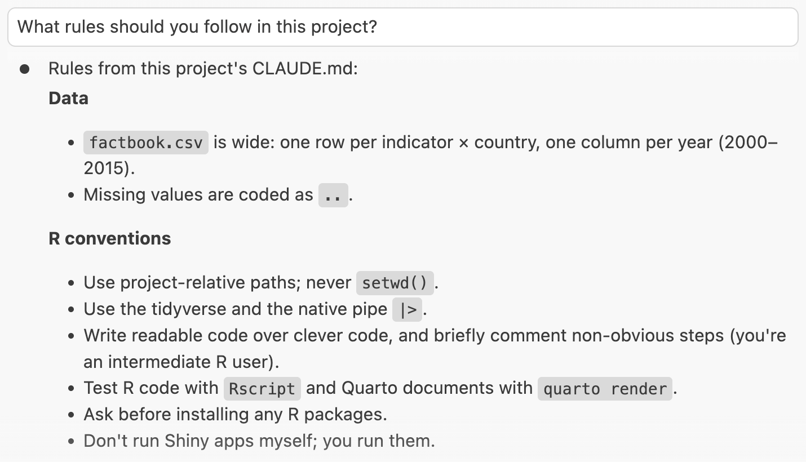{fig-align="center" width="78%" .no-border fig-alt="A screenshot of the Claude Code prompt box." .lightbox}

We'll see these instructions in action in the mini-project below.

::: {.callout-important collapse="true"}
#### Windows users: tell Claude where `Rscript` is _(Click to expand)_
On Windows, R's installer doesn't make `Rscript` available to commands run outside of R,
so Claude may struggle to find it.
To help it, run the following in the Positron console:

```{r}
normalizePath(file.path(R.home("bin"), "Rscript.exe"), winslash = "/")
```

And add the resulting path to the "R conventions" section of your `CLAUDE.md`, e.g.:

```{.markdown .file filename="CLAUDE.md (excerpt)"}
- Rscript is at `C:/Program Files/R/R-4.5.1/bin/Rscript.exe`
```

<hr style="height:1pt; visibility:hidden;" />
:::

::: {.callout-note collapse="true"}
#### More on using `CLAUDE.md` _(Click to expand)_

**Drafting a `CLAUDE.md` with `/init`**\
Instead of writing a `CLAUDE.md` from scratch, you can type `/init` in the prompt box:
Claude then looks through your project and drafts a `CLAUDE.md` for you to review and edit.
This can be a useful start in a larger existing project,
but the most valuable parts of a `CLAUDE.md` are things only you know:
what the project is about, where the data is, and how you want things done.

**Keep updating your `CLAUDE.md`**\
Start simple, and add to it whenever you notice yourself telling Claude the
same thing again, or Claude making the same mistake again.
Keep it short, though: it's read at the start of every conversation,
so it uses up tokens (and money) each time.

**Instructions are not strict rules**\
Claude will usually but not always follow the instructions in `CLAUDE.md`.

**Claude's memory**\
Claude also keeps **memory** notes for itself:
when you correct it or tell it about your preferences, it _may_ save a note,
which is loaded into future conversations in the same project.
Type `/memory` in the prompt box to see and edit these.
:::

## Mini-project: from a messy CSV to a report and an app

We'll work with the "factbook" data from the previous session,
World Bank data that is now in `factbook.csv`.
We'll have Claude clean it,
and then build a report and an app on top of the cleaned data.

### A quick look at the data

First, let's remind ourselves what the data looks like:
click on `factbook.csv` in the Explorer pane to open it in the Data Explorer.

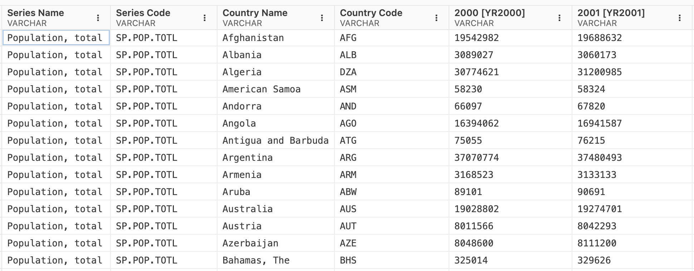{fig-align="center" width="95%" .no-border fig-alt="A screenshot of the Data Explorer showing the factbook.csv file." .lightbox}

Scroll around, including to the bottom of the file,
and you'll see a few things that make the data awkward to work with:

- It is in a "wide" format, with one column per year.
- The year column names, like `2000 [YR2000]`, are not just numbers.
- The year columns are text rather than numbers,
  because missing values are coded as `..`.
- The last rows are not data, but empty rows and notes about the database.

Let's see how Claude handles this.

::: {.callout-tip appearance="simple"}
We'll start a **new conversation** for each step below.
Thanks to the `CLAUDE.md` file and the files Claude creates along the way,
it doesn't need to remember the previous conversation.
:::

### Clean the data

> ***Write clean-factbook.R that reads factbook.csv and saves a tidy version***
> ***to factbook_tidy.csv with columns country, country_code, indicator,***
> ***year (numeric), and value. Check the result.***

Some things to watch for:

- How does Claude look at the data before writing code?
  (Notice that it doesn't read the entire 2 MB file,
  but runs a command to peek at the first few lines, like `head` on Mac and Linux.)
- Did it figure out the `..` missing values and the odd year column names by itself?
- Did it notice the notes at the bottom of the file, which aren't data?
  (Check the last rows of the tidy file.)
- How did it "check the result"?

Once it's done, click `factbook_tidy.csv` to open it in the Data Explorer.

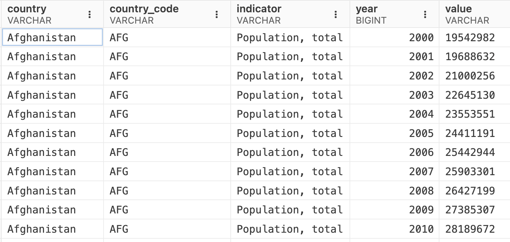{fig-align="center" width="80%" .no-border fig-alt="A screenshot of the Data Explorer showing the factbook_tidy.csv file." .lightbox}

Let's ask for one follow-up change:

> ***Add a continent column***

It's likely that Claude will want to use the `countrycode` package to do this,
and following our `CLAUDE.md` instructions,
it will ask for permission to install the package first:

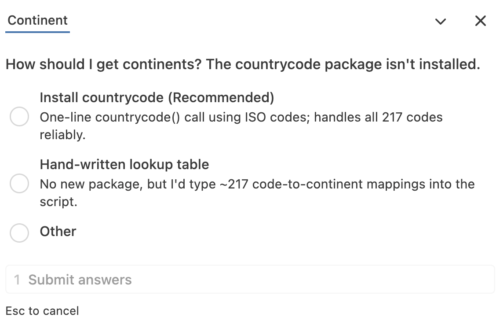{fig-align="center" width="70%" .no-border fig-alt="A screenshot of the Claude Code prompt box." .lightbox}

Let's take another quick look at the data in the Data Explorer,
to see if the continent column looks right.

### A Quarto report with gt tables

This is a bigger task, so we'll first ask Claude for a **plan**.
Start a new conversation, click on the permission mode, and select **Plan** mode.
Then, submit:

> ***Create a Quarto report report.qmd that summarizes how countries changed between***
> ***2000 and 2015, using factbook_tidy.csv. Include 3-4 ggplot figures,***
> ***a gt table of the 10 countries with the largest growth in GDP per capita,***
> ***with color-coded cells and a small plot of the trend in each row,***
> ***and a short narrative for each section.***
> ***Make the plots and table attractive but also readable***
> ***Render it to HTML and fix any errors.***

Claude will explore the files and then present a plan as a Markdown document.
Read it: for example, how did Claude interpret "largest growth in GDP per capita":
in dollars or in percent?
If you want to change anything, tell Claude --- or edit the plan directly.
Then approve the plan, choosing the option to approve edits manually
(this switches Claude back to **Manual** mode), and let Claude get to work.

When it's done, open `report.html` (e.g. right-click it in the Explorer and
open it in the Viewer, or in your browser).

<!-- TODO screenshot: img/report.png (the rendered report, incl. the gt table) -->

::: exercise
####  Exercise: Check the report {-}

1. Look through the report. Are the plots and the table sensible?

2. Check one number in the narrative text:
   is it computed in an R code chunk, or did Claude type it in?
   If the latter, check it against the data.

3. Ask Claude for a change of your choice,
   e.g. a different indicator, an extra figure, or a different table layout.
:::

::: {.callout-warning}
#### Verify, don't trust
Agents can write confident text about numbers they never computed.
In a real report, numbers in the text should come from code
(e.g. with [inline R code](https://quarto.org/docs/computations/inline-code.html){target="_blank"}),
so that you can check, rerun, and update them.
You could add this as a rule to your `CLAUDE.md`!
:::

### Ohio State branding with `_brand.yml`

[brand.yml](https://posit-dev.github.io/brand-yml/){target="_blank"} is a format
to define your organization's colors, fonts, and logos in a single file, `_brand.yml`,
which Quarto (and Shiny) then use to style your documents.

Download [this `_brand.yml` for Ohio State](osu_brand.yml){download="_brand.yml"}
and save it in your `codeclub-claude` folder as `_brand.yml`
(rename it if your browser saved it as `osu_brand.yml`).
Alternatively, create the file yourself and paste in the contents from the box below.
Then, have a look at the file.

::: {.callout-note collapse="true"}
#### Contents of `_brand.yml` _(Click to expand)_

```{.yaml .file filename="_brand.yml"}
# A _brand.yml for Ohio State-styled Quarto documents and Shiny apps
# Colors follow OSU's brand palette; fonts are freely available Google Fonts
# stand-ins for OSU's Buckeye Sans/Serif

meta:
  name:
    short: Ohio State
    full: The Ohio State University
  link: https://www.osu.edu

color:
  palette:
    scarlet: "#BA0C2F"
    gray: "#A7B1B7"
    dark-gray: "#3F4443"
    light-gray: "#F2F2F2"
    black: "#212325"
    white: "#FFFFFF"
  foreground: black
  background: white
  primary: scarlet
  secondary: dark-gray
  light: light-gray
  dark: dark-gray

typography:
  fonts:
    - family: Source Sans 3
      source: google
      weight: [400, 600, 700]
      style: [normal, italic]
    - family: Source Serif 4
      source: google
      weight: [600, 700]
    - family: Source Code Pro
      source: google
  base:
    family: Source Sans 3
    line-height: 1.5
  headings:
    family: Source Serif 4
    weight: 700
    color: scarlet
  monospace: Source Code Pro
  link:
    color: scarlet
```
:::

In a new conversation:

> ***Apply the \_brand.yml in this folder to the report***

Quarto picks up a `_brand.yml` automatically for the overall look (fonts, colors of
headings and links), but the plots and tables need to be told about the brand colors,
which is where Claude comes in.

::: {.callout-note collapse="true"}
#### Having Claude create a `_brand.yml` _(Click to expand)_

You can also ask Claude to create a `_brand.yml` from scratch, for example:

> ***Create a \_brand.yml for Ohio State, using scarlet #BA0C2F and gray #A7B1B7***

Or point it to your lab's or organization's style guide (e.g., a PDF).
:::

### A small Shiny app

In a new conversation, submit:

> ***Create a small Shiny app app.R using bslib and our \_brand.yml, where I can pick***
> ***a country and an indicator, and see a line plot over 2000-2015 and a gt table***
> ***of the values. Keep it under 100 lines.***

Because of our `CLAUDE.md` instruction, Claude should not try to run the app itself.
Instead, open `app.R` and click the **Run App** button at the top of the editor:
the app will open in Positron's Viewer pane.

If you have time, ask for a follow-up change:

> ***Add the option to select a second country to compare against***

Also try to "break" the app: pick a country and indicator combination
for which there is no data. What happens?
If the app shows an error or an empty plot, ask Claude to handle this more gracefully.

<!-- TODO screenshot: img/shiny-app.png -->

### More ideas to try

Some other tasks that Claude Code is good at, and that are not too expensive:

- **Parameterized report**:
  "Turn report.qmd into a one-page country profile with the country as a parameter,
  and render it for Ghana, Peru, and Viet Nam"
- **Slides**:
  "Turn the report into a short revealjs presentation with the same branding"
- **Functions and tests**:
  "Write a function that computes the percent change in an indicator between two
  years, with testthat tests, and run the tests"
- **Explain unfamiliar code**:
  open a script of your own (or an old one from someone else) and ask
  "Explain this script, and add comments where needed"
- **Translate code**:
  "Rewrite this base R code with the tidyverse" or
  "Translate this Python code to R"
- **A map**: "Make a world map of CO2 emissions per capita in 2015"
- **Code review**:
  "Review clean_factbook.R for bugs, unclear code, and hard-coded values"
- **README**:
  "Write a README.md that explains what this project does and how to reproduce the results"

## Appendix {#managing-context-and-cost}

### Agents fill up the context window quickly

A model's **context window** holds everything in the conversation,
and performance degrades as it fills up.
With an agent, this happens much faster than with a chatbot:
every file Claude reads and every command output it sees goes into the context too.
To see how full the context window is, type **`/context`** in the prompt box.

### Start fresh often {#start-fresh}

Today, we've started a **new conversation** for each new task.
That's a good habit:
Claude can get confused when you switch topics within a conversation,
and a long conversation is slower and more expensive,
because with every new prompt, the _entire_ conversation is sent to the model again.

To make re-sending the conversation cheaper,
the part that hasn't changed since the previous turn is **cached**,
and cached tokens cost only about one tenth of the regular price.
However, with an API key like ours, the cache **expires** after only **5 minutes**
without activity --- the clock icon in the prompt box shows how much time is left.
After that, your next message reprocesses the entire conversation at the full price.
So when you come back to a long conversation after a break,
consider starting a new one instead.

If you do want to continue a long conversation, type **`/compact`** in the prompt box:
Claude then replaces the conversation so far with a summary, which frees up context.

### Cost

Every token costs money, and your API key has a limited budget.
To see an **estimate** of what the current conversation has cost so far,
type `/usage` in the prompt box.

To keep costs down:

- Stick to **Sonnet** at **Medium** effort (the default in your settings file).
- **Start fresh** for each new task, and point Claude to specific files.
- Don't ask Claude to "read" or "analyze" large data files:
  have it write code that does the analysis instead.
- For general questions, like explaining a concept or a function,
  a browser-based chat (e.g. Gemini or Copilot through your OSU account)
  works just as well and doesn't use your API key's budget.

::: {.callout-note collapse="true"}
#### API pricing vs. personal subscriptions _(Click to expand)_
Paying per token through an API key, as we do here, is **much** more expensive than
a personal subscription to a service like Claude, which has a fixed monthly fee.
A day of heavy agentic coding through an API can easily cost more than a month's subscription.
However, personal accounts are not approved for institutional data,
which includes your unpublished research data.
:::

### Good habits when working with an agent

#### Getting good help {-}

- **Be explicit.** Point Claude to the relevant files, and put your conventions and rules
  in `CLAUDE.md`.
- **Start fresh** for each new task, and keep conversations focused.
- **Use Plan mode** for bigger tasks, and review the plan before Claude starts.

#### Checking and keeping the results {-}

- **You own the result.** Read every proposed edit and command before approving it.
- **Verify, don't trust.** When Claude says something "works", that may be a prediction
  rather than a test result. Run the code yourself, and check results independently.
- **Results should come from code you can rerun.** Let Claude help you write code that you
  review, run, and keep; don't rely on numbers or conclusions it only reports in the chat.
- **Commit before, review after.** Use Git so that you can see and undo what Claude changed
  (Positron's Source Control view makes this easy).
- **Keep a record** of how you used AI, which journals increasingly ask you to disclose
  (see the box below).

::: {.callout-note collapse="true"}
#### Documenting your AI use _(Click to expand)_

**Save your conversations**\
Claude saves your conversations automatically, but not in your project,
and in a format that's not easy to read.
To save a conversation in your project as a plain-text file,
type `/export` in the prompt box.

**Let Claude keep a diary**\
For a concise overview, you can let Claude keep a diary of key findings and decisions,
by adding something like this to your `CLAUDE.md`:

```{.markdown .file filename="CLAUDE.md (excerpt)"}
## AI diary

- After completing a task, add an entry at the bottom of `doc/ai-diary.md`
  with the date, what I asked for, which files you created or changed,
  and any key decisions (including alternatives that were rejected)
- Keep entries short
```
:::

<hr style="height:1pt; visibility:hidden;" />
